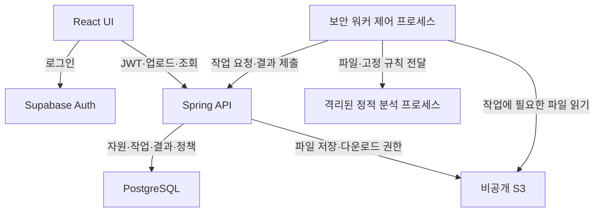

# 구조와 경계

> 상태: 팀 검토용 제안. 기존 인증·데이터 경계를 유지하면서 보안 검사 연결 구조를 추가한 수정안이다. 새 논리 모델·상태·작업 처리 방식은 미구현이며, 실제 DB 스키마나 구현된 API를 뜻하지 않는다.

## 1. 문서와 구성 요소의 책임

제품 목표·단계·결정 상태는 [PLAN.md](PLAN.md), 검사 규칙·근거·지원 범위는 [SECURITY_DESIGN.md](SECURITY_DESIGN.md), 기존 기능 비교와 제품 가설의 평가는 [DIFFERENTIATION.md](DIFFERENTIATION.md)에서 관리한다. 이 문서는 시스템 배치, 데이터 관계, 접근 권한과 실패 경계를 다룬다.

| 위치 또는 구성        | 책임                                                                         |
| --------------------- | ---------------------------------------------------------------------------- |
| `frontend/`           | React UI. 인증, 워크플로·리비전, 검사·비교·수정·공개 기능별 영역             |
| `backend/`            | Spring API. 검증된 사용자, 자원 소유권, 저장, 작업 처리, 결과·정책·공개 관리 |
| `contracts/`          | 구현된 OpenAPI와 합성 샘플. 미래 API 제안은 설계 문서에 둠                   |
| `docs/`               | 제품 범위·구조·보안 설계·운영 준비                                           |
| `.github/`            | CI와 작업 템플릿                                                             |
| 별도 보안 워커 저장소 | 작업 계약에 따른 파일 분석과 정규화한 결과 제출                              |
| Supabase PostgreSQL   | 서비스 메타데이터, 리비전·검사·정책·공개 기록 및 제안된 작업 큐              |
| 비공개 S3             | 불변 원본·수정본 JSON과 배포용 파일                                          |

프론트 앱 하나, 백엔드 앱 하나를 유지한다. 과도한 공통 추상화나 다수의 Gradle 모듈을 만들지 않는다. 워커는 분석기 실행·장애·자원 경계를 분리하는 별도 프로세스로 배치한다. 의미 검색은 별도 기능 계약이 필요한 확장 지점이다.

### 제안 구성

## 2. 인증: 기존 선택 유지

Google 로그인과 사용자 세션·토큰 발급은 Supabase Auth가 담당한다. React는 Bearer Access Token을 Spring API로 전달한다. Spring은 토큰 검증 후 서비스 자원의 소유권을 검사한다.

React의 Supabase SDK가 PKCE 로그인과 토큰 갱신을 관리한다. SDK의 브라우저 지속 저장을 사용하므로 토큰은 JavaScript에서 접근 가능하며 HttpOnly 쿠키 방식과 동일한 보호를 제공하지 않는다. 임의 HTML 삽입을 피하고 토큰을 로그·URL·분석 도구에 보내지 않는다. 배포 시 CSP를 설정한다. 향후 refresh token을 HttpOnly 쿠키로 옮기려면 갱신 주체와 CSRF 경계를 포함한 별도 설계가 필요하다.

Supabase의 RTR과 재사용 탐지 기능을 사용한다. 병렬 갱신을 위한 공급자 예외를 인정하고 자체 회전 DB나 타이머를 중복 구현하지 않는다. Supabase 내부의 인증 세션은 존재하지만 우리 API는 HttpSession 로그인에 의존하지 않는다.

백엔드는 비대칭 JWKS 서명, issuer, audience, 만료를 검증한다. Supabase 사용자 `sub`를 식별자로 사용하며, 프론트가 넘긴 이메일·owner ID는 인증 근거로 사용하지 않는다. 로그인용 사용자 토큰만 허용하고 secret/service-role 키를 사용자 인증으로 취급하지 않는다. JWT를 단순 디코딩한 값으로 권한을 판정하지 않는다.

로그아웃은 브라우저 토큰을 지우고 공급자의 갱신 세션을 종료한다. 이미 발급된 JWT는 만료 전까지 로컬 서명 검증에 통과할 수 있다. 즉시 폐기가 필요하면 별도 서버 확인·차단 설계를 추가한다.

## 3. 사용자와 워커의 권한 경계

### 사용자 자원

워크플로의 소유권을 기준으로 리비전·검사 실행·탐지 결과·수정안·다운로드 권한을 확인한다. 하위 객체의 ID를 안다는 사실은 권한이 아니다. 모든 경로에서 하위 객체가 속한 워크플로와 사용자 관계를 확인한다.

개인 비공개가 기본값이다. 공개 기능을 추가할 때는 선택한 리비전, 공개용 설명, 마스킹한 결과만 공개한다. 부모 리비전·원본·내부 URL·비공개 검사 결과를 자동으로 따라 공개하지 않는다.

같은 사용자의 수정은 같은 워크플로의 자식 리비전으로 연결한다. 다른 사용자가 공개본을 가져가 수정하는 경우에는 자신의 새 워크플로를 만들고 별도 파생 출처 관계를 두는 방식을 제안한다. 타인 워크플로의 부모 관계에 직접 편입하는 방식은 사용하지 않는다. 파생 관계의 표시·삭제·재배포 정책은 공개 기능 전에 확정한다.

### 워커와 분석 프로세스

워커는 사용자 토큰과 구분되는 서비스 주체로 내부 작업 API에 접근하도록 설계한다. 사용자 API의 기존 인증 검증을 완화하지 않는다. 서비스 주체에 허용하는 범위는 작업 요청·진행 보고·해당 작업 결과 제출로 제한한다.

워커 제어 프로세스는 배정된 파일만 제한된 권한으로 가져온다. 개별 분석 프로세스에는 전체 DB·S3 자격 증명을 전달하지 않는다. 분석 프로세스의 네트워크는 기본 차단하고, 작업 디렉터리·읽기 대상·CPU·메모리·시간·출력량을 제한한다. 제어 프로세스의 통신도 내부 API와 필요한 파일 접근으로 한정한다.

검사 엔진·규칙·버전은 배포 설정에서 고정한다. 업로드 파일이 규칙, 무시 설정, 실행 옵션이나 설치할 패키지를 선택하게 하지 않는다. 사용자 JSON의 코드·표현식은 평가하거나 실행하지 않는다.

## 4. 논리 데이터 모델 제안

아래는 책임을 구분하기 위한 논리 모델이다. 테이블명·열·타입·인덱스·삭제 동작은 구현 이슈에서 확정하고 마이그레이션으로 관리한다.

| 개념             | 주요 관계와 책임                                                                                         |
| ---------------- | -------------------------------------------------------------------------------------------------------- |
| User/Profile     | Supabase 사용자 ID와 필요한 서비스 프로필. 자체 비밀번호·토큰 회전 저장소를 만들지 않음                  |
| Workflow         | 소유자·제목·설명 등 논리적인 자원                                                                        |
| Revision         | Workflow, 같은 Workflow의 부모, 서버 발급 순번, 작성자·시간, 불변 파일 식별                              |
| Artifact         | 서버 생성 S3 키, 실제 바이트의 해시, 크기, 저장 상태. Revision에 포함할지 별도 테이블로 둘지는 후속 결정 |
| ScanRun          | 대상 Revision·파일 해시, 파서·어댑터·도구·규칙 버전, 실행 상태·시각·분석 범위                            |
| Finding          | ScanRun에 속하는 탐지. 규칙, 노드·필드·흐름, 심각도·근거 수준, 마스킹한 증거                             |
| AnalysisJob      | 검사 작업의 대기·임대·재시도·시도 식별자. 분석 결과의 진실과 별도 관리                                   |
| PolicyProfile    | 사용 목적·허용 목적지·데이터 종류·환경 조건. 사용자 선언과 확인된 사실 구분                              |
| PolicyEvaluation | 특정 ScanRun과 정책·조건 스냅샷에 대한 허용·검토·차단·판단 불가 결과                                     |
| FindingReview    | 오탐 판단·위험 수용의 판단자·사유·범위·유효 기간. 원본 Finding을 삭제하거나 바꾸지 않음                  |
| PatchProposal    | 기준 Revision·해시, 수정 명세, 적용으로 생성된 자식 Revision과 재검사 관계                               |
| Publication      | 공개한 정확한 Revision·정책 평가, 공개자·시각·공개 및 철회 상태                                          |
| AuditEvent       | 주요 행위의 주체·대상·결과. 원본 비밀정보나 유효한 다운로드 URL을 기록하지 않음                          |

한 Revision은 여러 ScanRun을 가질 수 있다. 규칙 갱신이나 명시적인 재검사로 새 실행을 추가하며, 이전 결과를 덮어쓰지 않는다. 같은 기술적 탐지라도 사용 정책에 따라 다른 판단이 가능하므로 분석 결과와 정책 평가를 분리한다.

### 리비전·파일의 불변 조건

- 같은 Workflow 안의 순번은 DB 제약과 동시성 제어를 함께 사용해 발급한다. 번호 자체로 계보를 추정하지 않는다.
- 부모 Revision은 같은 Workflow에 속하며 생성자가 접근할 수 있어야 한다. 부모 연결 변경·순환을 허용하지 않는 불변 생성 모델을 사용한다.
- 저장된 파일은 덮어쓰지 않는다. 수정·정제·비밀정보 제거로 배포 파일의 바이트가 바뀌면 반드시 새 Revision을 만들고 그 파일을 다시 검사한다. 별도 Artifact 테이블을 사용하더라도 공개할 파일은 정확한 Revision의 파일로 연결한다.
- 실제 검사 대상 바이트의 SHA-256을 서버에서 계산해 연결하는 방식을 제안한다. 클라이언트가 주장한 해시나 S3 ETag를 실제 바이트 해시로 간주하지 않는다.
- 정규화한 그래프의 의미 비교용 해시는 원본 파일 해시와 별도 개념이다. 의미가 비슷하다는 이유로 다른 바이트에 기존 검사 결과를 붙이지 않는다.
- 파일 중복 판별과 의미 검색은 분리한다. 다른 사용자의 비공개 파일 존재를 해시 검색·중복 안내로 노출하지 않는다.
- 공개·다운로드 대상의 실제 파일 식별은 검사·정책 평가에 연결된 대상을 사용한다. 공개를 위해 내용이 바뀌면 변경된 파일을 다시 검사한다.

## 5. 상태 모델 제안

다음은 개념 수준의 상태이며 실제 enum과 전이 조건은 검사 계약 이슈에서 확정한다.

| 구분      | 상태 예                                                  | 의미                                              |
| --------- | -------------------------------------------------------- | ------------------------------------------------- |
| 검사 실행 | queued, running, completed, failed, timed_out, cancelled | 프로세스가 어디까지 수행됐는가                    |
| 분석 범위 | checked, partial, unsupported, unknown                   | 어떤 항목·노드·경로를 확인했고 어디가 미확인인가  |
| 정책 판단 | allow, review, block, inconclusive                       | 해당 정책과 사용 조건에서 어떤 후속 처리를 하는가 |
| 공개      | private, submitted, published, withdrawn                 | 선택한 리비전의 배포 상태                         |

검사가 완료돼도 필수 경로가 미지원이면 정책 판단은 불완전할 수 있다. 오류·시간 초과·미지원은 탐지 0건과 구분한다. 분석 범위는 항목·노드·버전별로 표현하고 하나의 안전 비율로 바꾸지 않는다.

새 후보 리비전의 검사나 검토가 진행 중이어도 기존에 공개한 다른 리비전의 상태를 자동 변경하지 않는다. 규칙 갱신 후 재평가 결과가 달라질 때 기존 공개본의 처리·알림·철회 정책은 별도 결정한다.

## 6. 비동기 작업 처리 제안

초기 권장안은 PostgreSQL의 작업 테이블을 사용하는 방식이다. 이는 새 제안이며 기존 확정 인프라가 아니다. DB 연결 수·처리량·운영 요구를 확인하고 구현 이슈에서 채택한다.

### 정상 처리

1. API가 사용자 권한과 크기·깊이·구조 등 업로드 제한을 확인한다.
2. 서버 생성 키로 파일을 비공개 S3에 저장하고 실제 크기·해시를 확인한다.
3. DB 트랜잭션으로 Revision, ScanRun, AnalysisJob의 관계를 확정한다.
4. 내부 작업 API가 짧은 트랜잭션으로 작업을 가져와 임대와 시도 식별자를 발급한다.
5. 워커는 가져온 파일의 SHA-256을 계산해 작업에 기록된 해시와 대조한다. 일치한 파일은 DB 트랜잭션 밖에서 분석하고, 불일치는 실패 사유로 기록한다.
6. 제출된 결과의 작업·시도·입력 해시·엔진과 규칙 버전을 검증한다.
7. 결과를 해당 실행에 저장하고 정책 평가를 별도로 수행한다.

여러 워커가 작업을 가져가는 경우 행 잠금과 `SKIP LOCKED`를 활용하는 방식을 검토한다. 작업 테이블의 사용 목적과 잠금 범위를 구현 이슈에 명시한다. 분석이 오래 걸리는 동안 DB 잠금이나 트랜잭션을 유지하지 않는다.

### 실패·중복·재시도

- 작업 임대가 만료되면 정해진 횟수·조건에 따라 재시도한다.
- 같은 제출을 여러 번 받아도 하나의 시도 결과가 중복 적용되지 않도록 멱등성을 보장한다.
- 이전 임대 또는 실패한 시도의 늦은 결과는 최신 시도를 덮어쓰지 못한다.
- 다른 리비전·해시·규칙 버전의 결과 제출을 거부한다.
- 실행 실패는 오류 상태로 기록하고 검사 완료 또는 위험 0건으로 바꾸지 않는다.
- 작업 취소·삭제 중 제출 결과의 처리도 전이 조건에 포함한다.

향후 외부 메시지 큐를 쓰면 DB 기록과 메시지 발행의 이중 쓰기를 고려해 outbox 등을 설계한다. DB 작업 테이블만으로 처리하는 초기안에 외부 큐용 outbox를 의무적으로 중복 추가하지 않는다.

## 7. PostgreSQL 경계와 운영 연결

Supabase PostgreSQL은 백엔드에서 접속한다. 브라우저의 Data API 직접 접근은 초기 구성에 포함하지 않는다. 노출된 스키마에 테이블을 추가한다면 grants와 RLS를 함께 구성한다.

Spring이 검증한 JWT의 사용자 문맥이 일반 JDBC 연결에 자동 전달된다고 가정하지 않는다. 사용자별 인가는 API에서 검증한다. RLS를 추가 방어선으로 도입하면 사용자 문맥 전달, 트랜잭션·연결 풀 경계, 실제 DB 역할의 우회 권한을 함께 설계하고 부정 사례로 확인한다.

Data API에 노출하지 않는 서비스 전용 스키마와 최소 권한의 런타임·마이그레이션 역할을 제안한다. Supabase 관리 스키마는 서비스 마이그레이션의 대상에서 제외한다. DB 비밀번호나 secret/service-role 키를 브라우저·샘플·로그에 전달하지 않는다.

마이그레이션 도구는 하나로 정하고 스키마 변경을 버전 관리한다. 운영에서 애플리케이션의 자동 스키마 변경에 의존하지 않는다. 개발·운영 환경을 분리하고, TLS 서버 검증·연결 풀의 전체 연결 수·백업·복원·삭제 정책을 실제 배포 환경에서 확인한다. 지속 실행되는 Spring 서버는 배포 네트워크에 맞춰 직접 연결 또는 세션 풀러를 검토한다. 구체적인 연결 방식·마이그레이션 도구·설정 이름은 기반 구현 이슈에서 확정해 [SETUP.md](SETUP.md)에 반영한다.

## 8. S3와 업로드 경계

S3 버킷은 비공개다. 서버 생성 객체 키를 쓰고 승인한 사용자에게만 짧은 수명의 다운로드 URL 또는 스트리밍 응답을 제공한다. presigned URL은 유효 기간 동안 접근 가능한 비밀값처럼 다룬다. S3 versioning과 앱의 Revision 관계는 별개다.

DB와 S3 작업은 원자적이지 않다. 파일 저장 후 DB 확정 실패, DB 작업 확정 후 파일 접근 실패, 삭제 중 실패를 각각 다룬다. 미완료 업로드·고아 객체 정리와 재시도 절차를 구현하며, 작업 성공으로 보고하기 전에 필요한 저장 조건을 확인한다.

JSON 파싱과 허용 크기·깊이·노드 수·구조 검사를 수행한다. 수치와 보관 기간은 업로드 기능 전에 확정한다. 파싱 성공을 내용의 안전성 보증으로 사용하지 않는다. workflow 코드·표현식은 실행하지 않는다.

원본 본문·인증 헤더·원문 비밀정보·다운로드 URL을 로그에 남기지 않는다. 오류 메시지와 분석 결과에서도 마스킹을 적용한다. 기본 삭제·보관·백업 정책은 실제 사용자 파일을 저장하는 업로드 기능 출시 전에 확정한다. 공개·파생 관계에 따른 추가 처리 방식은 공개 기능 출시 전에 확정한다.

## 9. 수정·재검사·공개의 일관성

수정안은 기준 리비전과 파일 해시에 묶는다. 수정안 적용 시 현재 선택한 기준이 일치하는지 확인하고 새 리비전을 생성한다. 부모 파일을 덮어쓰거나 이전 검사 결과를 수정본으로 옮기지 않는다.

보안 변화 비교에는 어떤 두 리비전과 어떤 규칙 버전을 비교했는지 남긴다. 가능하면 같은 분석 버전으로 양쪽을 다시 검사해 비교하며 기존 실행 이력도 보존한다. 경고가 사라진 원인이 수정, 규칙 변경, 미지원 경로, 실행 실패 중 무엇인지 구분하는 기준은 [SECURITY_DESIGN.md](SECURITY_DESIGN.md)를 따른다.

공개 기록은 정확한 리비전·검사·정책 평가와 연결한다. 검사 결과를 공개용으로 정제하는 것과 실제 배포 파일을 변경하는 것을 구분한다. 배포 파일의 바이트가 바뀌면 새 리비전을 생성하고 재검사한다. 해시나 서명은 파일과 기록의 연결을 확인하는 수단이며 안전성 자체의 증명으로 표현하지 않는다.

## 10. 운영과 검증

배포 완료는 코드 존재나 상태 확인 API의 성공만으로 판단하지 않는다. 실제 인증·DB·S3·워커 연결, 접근 권한, 실패 복구, 로그·비밀정보 처리 결과를 기록한다. 애플리케이션 생존 상태와 필수 의존성 준비 상태는 구분하는 방향으로 설계한다.

검증에는 다른 사용자의 하위 객체 접근, 중복·늦은 작업 결과, 파일 해시 불일치, 업로드 중간 실패, 파서 자원 한도, 공개 시 비공개 관계 노출을 포함한다. 이는 새 기능을 구현할 때의 완료 조건이며 현재 통과한 테스트 목록이 아니다.

업로드한 워크플로의 임의 실행은 이 구조에 포함하지 않는다. 방어 동작과 수정 효과는 팀이 관리하는 합성 워크플로와 테스트 전용 서비스에서 검증한다. 운영 DB·사용자 자격 증명과 격리한다. 실행형 제품 기능을 추가하려면 별도 범위·네트워크·권한·부작용 설계를 검토한다.

## 11. 출처와 유지 원칙

- [문서 반영 전 main](https://github.com/serendipity-sec/workflow-hub/tree/3b45190e55c13826dad1a1e4615bdfbcb0b150a0)
- [Supabase sessions/RTR](https://supabase.com/docs/guides/auth/sessions)
- [Supabase signing keys](https://supabase.com/docs/guides/auth/signing-keys)
- [Supabase PostgreSQL 연결](https://supabase.com/docs/guides/database/connecting-to-postgres)
- [Supabase Data API 접근 권한](https://supabase.com/docs/guides/api/securing-your-api)
- [Supabase RLS](https://supabase.com/docs/guides/database/postgres/row-level-security)
- [PostgreSQL SELECT와 행 잠금](https://www.postgresql.org/docs/current/sql-select.html)

팀 결정과 구현 근거가 생기면 관련 이슈와 문서를 갱신한다.
