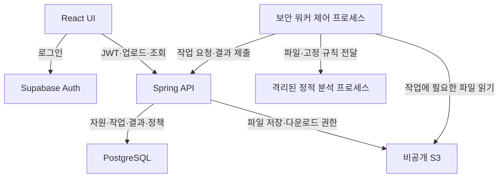

# 구조와 경계

> 상태: 팀 검토용 보안 확장 제안. #8·#10에서 확정·구현한 워크플로별 버전 메타데이터와 인증 기반을 유지한다. 파일 해시·검사·정책·공개·작업 처리 모델은 미구현이다. 현재 DB 구조와 후속 제안을 4절에서 구분한다.

## 1. 문서와 구성 요소의 책임

제품 목표·단계·결정 상태는 [PLAN.md](PLAN.md), 검사 규칙·근거·지원 범위는 [SECURITY_DESIGN.md](SECURITY_DESIGN.md), 기존 기능 비교와 제품 가설의 평가는 [DIFFERENTIATION.md](DIFFERENTIATION.md)에서 관리한다. 이 문서는 시스템 배치, 데이터 관계, 접근 권한과 실패 경계를 다룬다.

| 위치 또는 구성        | 책임                                                                         |
| --------------------- | ---------------------------------------------------------------------------- |
| `frontend/`           | React UI. 인증, 워크플로·버전, 검사·비교·수정·공개 기능별 영역               |
| `backend/`            | Spring API. 검증된 사용자, 자원 소유권, 저장, 작업 처리, 결과·정책·공개 관리 |
| `docs/`               | 제품 범위·구조·보안 설계·운영 준비                                           |
| `.github/`            | CI와 작업 템플릿                                                             |
| 별도 보안 워커 저장소 | 작업 계약에 따른 파일 분석과 정규화한 결과 제출                              |
| Supabase PostgreSQL   | 서비스 메타데이터, 버전·검사·정책·공개 기록 및 제안된 작업 큐                |
| 비공개 S3             | 불변 원본·수정본 JSON과 배포용 파일                                          |

프론트 앱 하나, 백엔드 앱 하나를 유지한다. 과도한 공통 추상화나 다수의 Gradle 모듈을 만들지 않는다. 워커는 분석기 실행·장애·자원 경계를 분리하는 별도 프로세스로 배치한다. 의미 검색은 별도 기능 계약이 필요한 확장 지점이다.

### 1차 구성과 선택적 확장

[PLAN 5절](PLAN.md#5-단계별-구현-순서-제안)의 1차 범위는 저장·검사·근거·수동 수정본·비교·특정 버전 공개를 이 구성으로 연결한다. 자동 수정기, 실행 환경 수집기, 동적 공격 평가기와 운영 중 통제는 초기 필수 구성 요소가 아니다. 특히 업로드 워크플로를 실행하지 않는 원칙은 고도화 대기 여부와 무관하게 유지한다.

노드 해석과 외부 검사기 출력은 워커의 어댑터에서 정규화하고, API는 명시한 버전의 검사 결과 계약을 받는다. 새 분석기를 추가하면 계약 호환성을 확인하고 새로운 ScanRun으로 기록한다. UI·정책 계층은 개별 도구의 원출력이나 경고 수에 직접 의존하지 않고, 근거·분석 범위·미지원 상태를 사용한다. 확장을 위해 범용 플러그인 시스템을 먼저 구현하지 않는다.

### 제안 구성

## 2. 인증: 기존 선택 유지

Google 로그인과 사용자 세션·토큰 발급은 Supabase Auth가 담당한다. React는 Bearer Access Token을 Spring API로 전달한다. Spring은 토큰 검증 후 서비스 자원의 소유권을 검사한다.

React의 Supabase SDK가 PKCE 로그인과 토큰 갱신을 관리한다. SDK의 브라우저 지속 저장을 사용하므로 토큰은 JavaScript에서 접근 가능하며 HttpOnly 쿠키 방식과 동일한 보호를 제공하지 않는다. 임의 HTML 삽입을 피하고 토큰을 로그·URL·분석 도구에 보내지 않는다. 배포 시 CSP를 설정한다. 향후 refresh token을 HttpOnly 쿠키로 옮기려면 갱신 주체와 CSRF 경계를 포함한 별도 설계가 필요하다.

Supabase의 RTR과 재사용 탐지 기능을 사용한다. 병렬 갱신을 위한 공급자 예외를 인정하고 자체 회전 DB나 타이머를 중복 구현하지 않는다. Supabase 내부의 인증 세션은 존재하지만 우리 API는 HttpSession 로그인에 의존하지 않는다.

백엔드는 비대칭 JWKS 서명, issuer, audience, 만료를 검증한다. Supabase 사용자 `sub`를 식별자로 사용하며, 프론트가 넘긴 이메일·owner ID는 인증 근거로 사용하지 않는다. 로그인용 사용자 토큰만 허용하고 secret/service-role 키를 사용자 인증으로 취급하지 않는다. JWT를 단순 디코딩한 값으로 권한을 판정하지 않는다.

로그아웃은 브라우저 토큰을 지우고 공급자의 갱신 세션을 종료한다. 이미 발급된 JWT는 만료 전까지 로컬 서명 검증에 통과할 수 있다. 즉시 폐기가 필요하면 별도 서버 확인·차단 설계를 추가한다.

## 3. 사용자와 워커의 권한 경계

### 사용자 자원

워크플로의 소유권을 기준으로 버전·검사 실행·탐지 결과·수정안·다운로드 권한을 확인한다. 하위 객체의 ID를 안다는 사실은 권한이 아니다. 모든 경로에서 하위 객체가 속한 워크플로와 사용자 관계를 확인한다.

개인 비공개가 제품 기본값이다. 공개 기능을 추가할 때는 선택한 버전, 공개용 설명, 마스킹한 결과만 공개한다. 다른 비공개 버전·원본·내부 URL·비공개 검사 결과를 자동으로 따라 공개하지 않는다. 현재 DB에 공개 상태나 이 접근 제어 서비스가 구현됐다는 뜻은 아니다.

같은 워크플로를 업데이트하면 새 버전을 추가한다. #8에 따라 파생본은 독립 워크플로의 `v1`로 시작하며, 버전 테이블에 부모·자식 트리를 두지 않는다. 공개본의 출처 표시와 수정 작업의 기준·결과 버전 연결은 별도 기록으로 제안한다. 출처 기록은 다른 워크플로의 열람 권한을 부여하지 않는다. 파생 기능과 출처 표시·삭제·재배포 정책은 후속 구현 전에 확정한다.

### 워커와 분석 프로세스

워커는 사용자 토큰과 구분되는 서비스 주체로 내부 작업 API에 접근하도록 설계한다. 사용자 API의 기존 인증 검증을 완화하지 않는다. 서비스 주체에 허용하는 범위는 작업 요청·진행 보고·해당 작업 결과 제출로 제한한다.

워커 제어 프로세스는 배정된 파일만 제한된 권한으로 가져온다. 개별 분석 프로세스에는 전체 DB·S3 자격 증명을 전달하지 않는다. 분석 프로세스의 네트워크는 기본 차단하고, 작업 디렉터리·읽기 대상·CPU·메모리·시간·출력량을 제한한다. 제어 프로세스의 통신도 내부 API와 필요한 파일 접근으로 한정한다.

검사 엔진·규칙·버전은 배포 설정에서 고정한다. 업로드 파일이 규칙, 무시 설정, 실행 옵션이나 설치할 패키지를 선택하게 하지 않는다. 사용자 JSON의 코드·표현식은 평가하거나 실행하지 않는다.

## 4. 논리 데이터 모델 제안

### 현재 구현된 저장 구조

[#8](https://github.com/serendipity-sec/workflow-hub/issues/8)과 [#10](https://github.com/serendipity-sec/workflow-hub/pull/10)의 기준은 [V1 마이그레이션](../backend/src/main/resources/db/migration/V1__create_workflow_version_storage.sql)이다.

- `workflow_hub.workflows`: UUID 식별자, `owner_id`, 제목, 최초 등록 시각(`created_at`). 소유자는 검증된 Supabase JWT의 `sub`에 대응하는 문자열이며, 별도 사용자 테이블이나 `auth.users` 외래 키는 없다.
- `workflow_hub.workflow_versions`: UUID 식별자, 워크플로 외래 키, 버전 문자열, S3 객체 키, 생성 시각. `(workflow_id, version)`의 중복을 DB가 거부한다.
- #8에서 확정한 번호 정책은 새 워크플로의 첫 버전 `v1`, 작은 업데이트의 `v1.1`, `v1.2` 순 증가, 주요 업데이트의 `v2`와 같은 다음 정수 버전 증가다. 워크플로별로 관리하며, 변경 종류 선택·동시 발급·형식 검증 서비스는 후속 구현이다. 번호를 부모 관계나 보안 승인 순서로 해석하지 않는다.
- 파일 불변성은 제품 정책이다. 현재 스키마에 파일 해시·크기·부모·검사·정책·공개 필드나 변경 방지 트리거는 없으며, 덮어쓰기 방지는 업로드 API(#20)가 서버 생성 키와 S3 조건부 PUT(`If-None-Match: *`)으로 구현했으나 실제 S3에서는 검증하지 않았다.
- 최초 업로드 API(`POST /api/workflows`, #20), 소유자별 목록·상세·버전 조회 API(#23), 소유자용 원본 JSON 다운로드 API(#25)가 있다. 버전 업데이트 API는 후속 구현이다.
- [V3 마이그레이션](../backend/src/main/resources/db/migration/V3__add_workflow_created_at.sql)은 워크플로 최초 등록 시각을 기존 `v1.created_at`으로 채우며, `v1`이 없는 기존 행은 임의의 시각으로 채우지 않고 이관에 실패한다. 새 행에는 현재 시각을 기본값으로 쓴다. `updated_at`은 추가하지 않는다.
- 워크플로 목록은 최초 등록 시각·ID 내림차순, 버전 목록과 최신 버전 선택은 버전 등록 시각·ID 내림차순이다. 두 목록 모두 커서 페이지네이션(기본 20개, 1~100개)을 사용한다. 다른 소유자·없는 ID·잘못된 UUID의 상세와 버전 목록은 같은 404다. 정확한 응답·오류 계약은 컨트롤러 OpenAPI를 따른다.

### 보안 확장을 위한 논리 모델

아래 모델 중 Workflow와 WorkflowVersion은 위 저장 구조에 대응한다. 나머지 관계·필드·테이블 분리·인덱스·삭제 동작은 후속 구현 이슈에서 확정하고 새 마이그레이션으로 관리한다. 이미 병합된 V1을 새 제안에 맞춰 수정하지 않는다.

| 개념              | 주요 관계와 책임                                                                                                 |
| ----------------- | ---------------------------------------------------------------------------------------------------------------- |
| Workflow          | 구현된 소유자·제목·식별자. 공개 등 추가 메타데이터는 후속 확장                                                   |
| WorkflowVersion   | 구현된 Workflow 관계·버전 문자열·S3 키·생성 시각. 파일 무결성 정보는 후속 확장                                   |
| Artifact          | 서버 생성 S3 키, 실제 바이트의 해시, 크기, 저장 상태. WorkflowVersion에 포함할지 별도 테이블로 둘지는 후속 결정  |
| ScanRun           | 대상 WorkflowVersion·파일 해시, 파서·어댑터·도구·규칙 버전, 실행 상태·시각·분석 범위                             |
| Finding           | ScanRun에 속하는 탐지. 규칙, 노드·필드·흐름, 심각도·근거 수준, 마스킹한 증거                                     |
| AnalysisJob       | 검사 작업의 대기·임대·재시도·시도 식별자. 분석 결과의 진실과 별도 관리                                           |
| PolicyProfile     | 사용 목적·허용 목적지·데이터 종류·환경 조건. 사용자 선언과 확인된 사실 구분                                      |
| PolicyEvaluation  | 특정 ScanRun과 정책·조건 스냅샷에 대한 허용·검토·차단·판단 불가 결과                                             |
| FindingReview     | 오탐 판단·위험 수용의 판단자·사유·범위·유효 기간. 원본 Finding을 삭제하거나 바꾸지 않음                          |
| PatchProposal     | 기준 WorkflowVersion·해시, 수정 명세, 적용으로 생성된 새 WorkflowVersion과 재검사 관계. 버전 트리와 별도 기록    |
| Publication       | 공개한 정확한 WorkflowVersion·정책 평가, 공개자·시각·공개 및 철회 상태                                           |
| SourceRecord      | 외부 출처 URL·템플릿 ID·원본 커밋/파일 해시·확인 시점·사용 조건. 현재 파일 및 내부 파생 출처와의 관계            |
| DependencyContext | 하위 워크플로·패키지의 정확한 식별과 버전, 환경·권한 조건, 선언/확인/미확보 구분. 검사·정책 평가가 사용한 스냅샷 |
| AuditEvent        | 주요 행위의 주체·대상·결과. 원본 비밀정보나 유효한 다운로드 URL을 기록하지 않음                                  |

한 WorkflowVersion은 여러 ScanRun을 가질 수 있다. 규칙 갱신이나 명시적인 재검사로 새 실행을 추가하며, 이전 결과를 덮어쓰지 않는다. 같은 기술적 탐지라도 사용 정책에 따라 다른 판단이 가능하므로 분석 결과와 정책 평가를 분리한다.

위 표는 전체 논리 모델이며 모든 개념을 1차 독립 테이블로 구현하라는 목록이 아니다. 1차에는 버전·파일·검사/근거·작업·단순 공개 정책/평가·공개의 식별 관계를 구현하고, 수동 수정본의 기준/결과 버전을 명시적으로 연결한다. 자동 수정 기능이 없는 동안 PatchProposal 생성·적용 서비스는 요구하지 않는다. 세밀한 PolicyProfile·FindingReview, 의존성/환경 자동 수집은 해당 고도화를 채택할 때 확장할 수 있다.

다만 결과 계약에는 처음부터 계약·엔진·규칙 버전과 사용한 정책의 버전/조건, 분석 범위, 외부 출처·의존성·환경의 선언/확인/미확보를 구분할 자리를 둔다. 미확보 정보는 그 사유를 기록하며 가짜 확인 기록이나 기본 안전값으로 채우지 않는다. 추가 필드·테이블은 후속 마이그레이션으로 확장하고, 과거 실행이 어떤 정보에 근거했는지 보존한다.

### 버전·파일의 불변 조건

- 같은 Workflow 안의 버전 번호는 기존 DB unique 제약과 후속 서비스의 동시성 제어로 중복을 막는다. 서로 다른 Workflow는 같은 번호를 사용할 수 있다.
- 수정안의 기준·결과 버전과 비교할 두 버전은 명시적인 식별자로 기록하고 각각 접근 권한을 확인한다. 부모 필드나 번호의 크기로 수정 관계·안전성을 추정하지 않는다.
- 저장된 파일은 덮어쓰지 않는다. 수정·정제·비밀정보 제거로 배포 파일의 바이트가 바뀌면 반드시 새 WorkflowVersion을 만들고 그 파일을 다시 검사한다. 별도 Artifact 테이블을 사용하더라도 공개할 파일은 정확한 WorkflowVersion의 파일로 연결한다.
- 실제 검사 대상 바이트의 SHA-256을 서버에서 계산해 연결하는 방식을 제안한다. 클라이언트가 주장한 해시나 S3 ETag를 실제 바이트 해시로 간주하지 않는다.
- 정규화한 그래프의 의미 비교용 해시는 원본 파일 해시와 별도 개념이다. 의미가 비슷하다는 이유로 다른 바이트에 기존 검사 결과를 붙이지 않는다.
- 파일 중복 판별과 의미 검색은 분리한다. 다른 사용자의 비공개 파일 존재를 해시 검색·중복 안내로 노출하지 않는다.
- 공개·다운로드 대상의 실제 파일 식별은 검사·정책 평가에 연결된 대상을 사용한다. 공개를 위해 내용이 바뀌면 변경된 파일을 다시 검사한다.

### 외부 출처·의존성·실행 환경의 근거

출처 URL이나 제작자 배지는 파일 동일성·안전성의 증명이 아니다. 외부 원본의 식별과 우리 서비스에 들어온 파일의 실제 해시를 구분하며, 원본 변경 여부를 확인하지 못했다면 최신 상태라고 표시하지 않는다. 출처 기록은 자동 수집·다운로드·원본 실행을 허용하는 기능이 아니다. 수집·보관·재배포 조건과 라이선스 확인 방식은 별도 결정한다.

하위 워크플로와 커뮤니티 패키지는 확보한 정확한 파일/버전과 미확보 참조를 구분한다. n8n 노드의 `typeVersion`은 npm 패키지 버전이 아니다. 실제 패키지·런타임 버전이나 권한을 확보하지 못한 상태에서 의존성 취약점과 실행 안전성을 확정하지 않는다. 자격 증명 원문 대신 필요한 권한·유형·확인 출처를 최소한으로 기록하는 방향을 제안한다.

검사와 정책 평가는 사용한 파일·의존성·환경 정보의 확인 시점에 묶는다. 사용자 선언과 연동으로 확인한 정보는 별도 증거 수준으로 남긴다. 파일이 같아도 실제 계정 권한·하위 흐름·패키지·네트워크가 달라지면 과거 판단을 그대로 적용할 수 없다. 연동·재평가·알림 방식은 후속 결정이며 현재 JSON 검사 설계가 운영 상태를 감시한다는 뜻은 아니다.

## 5. 상태 모델 제안

다음은 개념 수준의 상태이며 실제 enum과 전이 조건은 검사 계약 이슈에서 확정한다.

| 구분      | 상태 예                                                  | 의미                                              |
| --------- | -------------------------------------------------------- | ------------------------------------------------- |
| 검사 실행 | queued, running, completed, failed, timed_out, cancelled | 프로세스가 어디까지 수행됐는가                    |
| 분석 범위 | checked, partial, unsupported, unknown                   | 어떤 항목·노드·경로를 확인했고 어디가 미확인인가  |
| 정책 판단 | allow, review, block, inconclusive                       | 해당 정책과 사용 조건에서 어떤 후속 처리를 하는가 |
| 공개      | private, submitted, published, withdrawn                 | 선택한 버전의 배포 상태                           |

검사가 완료돼도 필수 경로가 미지원이면 정책 판단은 불완전할 수 있다. 오류·시간 초과·미지원은 탐지 0건과 구분한다. 분석 범위는 항목·노드·버전별로 표현하고 하나의 안전 비율로 바꾸지 않는다.

새 후보 버전의 검사나 검토가 진행 중이어도 기존에 공개한 다른 버전의 상태를 자동 변경하지 않는다. 규칙 갱신 후 재평가 결과가 달라질 때 기존 공개본의 처리·알림·철회 정책은 별도 결정한다.

## 6. 비동기 작업 처리 제안

초기 권장안은 PostgreSQL의 작업 테이블을 사용하는 방식이다. 이는 새 제안이며 기존 확정 인프라가 아니다. DB 연결 수·처리량·운영 요구를 확인하고 구현 이슈에서 채택한다.

### 정상 처리

1. API가 사용자 권한과 크기·깊이·구조 등 업로드 제한을 확인한다.
2. 서버 생성 키로 파일을 비공개 S3에 저장하고 실제 크기·해시를 확인한다.
3. DB 트랜잭션으로 WorkflowVersion, ScanRun, AnalysisJob의 관계를 확정한다.
4. 내부 작업 API가 짧은 트랜잭션으로 작업을 가져와 임대와 시도 식별자를 발급한다.
5. 워커는 가져온 파일의 SHA-256을 계산해 작업에 기록된 해시와 대조한다. 일치한 파일은 DB 트랜잭션 밖에서 분석하고, 불일치는 실패 사유로 기록한다.
6. 제출된 결과의 작업·시도·입력 해시·엔진과 규칙 버전을 검증한다. 결과 저장과 같은 짧은 트랜잭션에서 현재 시도와 실행 중 상태가 일치하고, 서버/DB 시각 기준 임대가 아직 유효한지 원자적으로 확인한다.
7. 결과 저장과 같은 트랜잭션에서 해당 ScanRun과 적용할 정책 버전·조건 스냅샷을 가리키는 평가 대기 기록을 영속화한다. 결과와 평가 요청 중 하나만 저장되는 상태를 만들지 않는다.
8. 별도 정책 평가 처리가 대기 기록을 가져와 판단을 저장한다. 미처리·실패 기록은 복구 작업이 재개하며, ScanRun·정책 스냅샷 식별자를 기준으로 같은 평가가 중복 적용되지 않게 한다. 평가 처리 상태는 허용·검토·차단·판단 불가라는 판단 결과와 구분한다.

여러 워커가 작업을 가져가는 경우 행 잠금과 `SKIP LOCKED`를 활용하는 방식을 검토한다. 작업 테이블의 사용 목적과 잠금 범위를 구현 이슈에 명시한다. 분석이 오래 걸리는 동안 DB 잠금이나 트랜잭션을 유지하지 않는다.

### 실패·중복·재시도

- 작업 임대가 만료되면 정해진 횟수·조건에 따라 재시도한다.
- 같은 제출을 여러 번 받아도 하나의 시도 결과가 중복 적용되지 않도록 멱등성을 보장한다.
- 만료·실패·취소된 시도의 새 결과는 거부한다. 임대 만료 후 아직 재시도가 배정되지 않았어도 거부하며, 새 시도가 생긴 뒤에는 이전 시도가 최신 상태를 덮어쓰지 못한다. 이미 수락한 동일 제출의 재전송은 기존 응답과 평가 처리 상태를 반환하고 결과·정책을 다시 적용하지 않는다. 저장된 평가 대기·실패 기록의 복구는 별도 처리기가 담당하며 워커의 재전송에 의존하지 않는다.
- 다른 버전·해시·규칙 버전의 결과 제출을 거부한다.
- 실행 실패는 오류 상태로 기록하고 검사 완료 또는 위험 0건으로 바꾸지 않는다. 검사 저장 후 정책 평가 전 중단, 평가 실패·재시작·중복 실행을 검증한다. 정책 평가가 완료되지 않은 버전은 공개 대기이며, 검사 완료만으로 공개하지 않는다.
- 작업 취소·삭제 중 제출 결과의 처리도 전이 조건에 포함한다.

향후 외부 메시지 큐를 쓰면 DB 기록과 메시지 발행의 이중 쓰기를 고려해 outbox 등을 설계한다. DB 작업 테이블만으로 처리하는 초기안에 외부 큐용 outbox를 의무적으로 중복 추가하지 않는다.

## 7. PostgreSQL 경계와 운영 연결

백엔드는 `DATABASE_URL`(JDBC URL), `DATABASE_USERNAME`, `DATABASE_PASSWORD`로 PostgreSQL에 접속하고 시작 시 Flyway 마이그레이션을 적용한다. 연결·마이그레이션 실패는 시작 실패로 처리한다. 서비스 테이블은 `workflow_hub` 스키마에 두고 Supabase Data API의 exposed schemas에 추가하지 않는다. 브라우저의 Data API 직접 접근은 초기 구성에 포함하지 않는다. 향후 노출한다면 grants와 RLS를 함께 구성한다.

Spring이 검증한 JWT의 사용자 문맥이 일반 JDBC 연결에 자동 전달된다고 가정하지 않는다. 사용자별 인가는 API에서 검증한다. RLS를 추가 방어선으로 도입하면 사용자 문맥 전달, 트랜잭션·연결 풀 경계, 실제 DB 역할의 우회 권한을 함께 설계하고 부정 사례로 확인한다.

현재 하나의 datasource로 앱 시작 시 마이그레이션도 수행하므로 초기 연결 계정은 스키마·테이블·Flyway 이력을 관리할 권한이 필요하다. 런타임·마이그레이션 역할 분리는 운영 보강 제안이며 아직 적용되지 않았다. Supabase 관리 스키마는 서비스 마이그레이션의 대상에서 제외한다. DB 비밀번호나 secret/service-role 키를 브라우저·샘플·로그에 전달하지 않는다.

Flyway로 스키마 변경을 버전 관리하고 ORM의 자동 스키마 변경에 의존하지 않는다. 백엔드 테스트는 Testcontainers의 일회용 PostgreSQL을 사용한다. 개발·운영 환경을 분리하고, 실제 Supabase 연결, TLS 서버 검증·역할별 권한·연결 풀·백업·복원·삭제 정책은 배포 환경에서 별도 확인한다. 지속 실행되는 Spring 서버의 직접 연결 또는 세션 풀러 선택도 배포 네트워크에 맞춰 검토한다. 현재 실행 설정과 후속 운영 검증은 [SETUP.md](SETUP.md)를 따른다.

## 8. S3와 파일 접근 경계

비공개 S3에 서버 생성 객체 키로 원본을 저장한다(#20). S3 versioning과 앱의 WorkflowVersion 관계는 별개다.

`GET /api/workflows/{workflowId}/versions/{versionId}/download`(#25)는 검증된 JWT의 `sub`로 워크플로 소유권을 확인하고, 요청 버전이 해당 워크플로에 속하는지 확인한다. 조건을 모두 만족하면 DB에 기록된 객체 키로 비공개 S3를 읽고, 원본 바이트를 `200`과 `application/json` 첨부 응답으로 반환한다. 파일명은 `title-versionLabel.json` 형식이며 안전하지 않은 문자는 치환한다.

미인증 요청은 `401`이다. 타인 소유, 존재하지 않는 워크플로·버전, 서로 다른 워크플로와 버전의 조합은 S3 접근 전에 동일한 `404 WORKFLOW_VERSION_NOT_FOUND`로 처리한다. 원본 읽기 실패는 `503 STORAGE_UNAVAILABLE`로 처리한다.

DB와 S3 작업은 원자적이지 않다. 파일 저장 후 DB 확정 실패, DB 작업 확정 후 파일 접근 실패, 삭제 중 실패를 각각 다룬다. 미완료 업로드·고아 객체 정리와 재시도 절차를 구현하며, 작업 성공으로 보고하기 전에 필요한 저장 조건을 확인한다.

`POST /api/workflows`(#20)는 서버가 만든 키(`workflows/{workflowId}/{versionId}.json`)로 S3에 먼저 저장하고, 성공하면 workflow, `v1`, 멱등성 키를 한 DB 트랜잭션에서 기록한다. S3 저장이 실패하면 DB에 아무것도 만들지 않는다. 트랜잭션 본문(INSERT)에서 DB가 실패하면 롤백이 확실하므로 어떤 버전도 참조하지 않는 객체를 즉시 삭제 요청(`DeleteObject`)하고, 삭제도 실패하면 객체 키만 로그에 남긴다. 버킷 versioning을 끈 경우 이 삭제로 객체가 사라지지만, 켠 경우에는 삭제 마커만 생기고 이전 객체 버전이 남는다. 따라서 versioning을 켠다면 이전 버전 만료 lifecycle 규칙(보관 기간 포함)을 함께 두어야 하며, 규칙이 없으면 삭제된 것으로 간주하지 않는다([SETUP.md](SETUP.md#s3-업로드-저장소)). 본문이 끝난 뒤 커밋 단계에서 실패하면 커밋이 적용됐을 수 있으므로 버전 행을 확인해 있으면 성공으로 처리하고, 없거나 확인할 수 없으면 객체를 삭제하지 않고 `commit_unknown` 로그에 키를 남긴다. 남은 객체의 후속 정리 작업은 아직 없으며, 저장과 DB 커밋 사이에 프로세스가 중단돼도 같은 고아 객체가 남을 수 있다.

최초 업로드(#20)는 multipart의 `title`(선택)과 `file`(n8n JSON 한 개, 최대 5 MiB)을 받는다. 제목은 입력값, 없으면 JSON의 `name` 순서로 정하고 둘 다 없으면 `422`다. `Idempotency-Key` 헤더는 필수이며 `(owner_id, key)`당 최초 결과를 `idempotency_keys` 테이블에 기록한다. 같은 키와 같은 입력(제목과 파일 바이트의 SHA-256)의 재시도는 최초 `201`과 같은 ID를 반환하고, 같은 키에 다른 입력은 `409`다. 원본 바이트는 수정하지 않고 저장하므로, 사용자가 파일에 적은 값(`pinData`, 파라미터, Code 노드의 토큰 등)도 그대로 저장된다. 공개·공유·파생 기능을 열기 전에 비밀 값 탐지와 정리 절차가 먼저 필요하다.

JSON 파싱과 허용 크기·깊이·노드 수·구조 검사를 수행한다. 5 MiB 외의 수치와 보관 기간은 업로드 기능 전에 확정한다. 파싱 성공을 내용의 안전성 보증으로 사용하지 않는다. workflow 코드·표현식은 실행하지 않는다.

원본 본문·인증 헤더·원문 비밀정보·다운로드 URL을 로그에 남기지 않는다. 오류 메시지와 분석 결과에서도 마스킹을 적용한다. 기본 삭제·보관·백업 정책은 실제 사용자 파일을 저장하는 업로드 기능 출시 전에 확정한다. 공개·파생 관계에 따른 추가 처리 방식은 공개 기능 출시 전에 확정한다.

## 9. 수정·재검사·공개의 일관성

1차는 수정 방향을 안내하고 사용자가 고친 파일을 새 버전으로 업로드하는 방식이다. 기준 버전·해시와 결과 버전의 관계를 기록하고 양쪽의 권한을 확인한다. 자동 수정안 생성·적용은 선택적 고도화이며, 도입하면 수정안을 기준 버전·해시에 묶고 적용 시 기준 일치를 확인한다. 어느 방식도 기준 파일을 덮어쓰거나 이전 검사 결과를 수정본으로 옮기지 않는다.

보안 변화 비교에는 어떤 두 버전과 어떤 규칙 버전을 비교했는지 남긴다. 가능하면 같은 분석 버전으로 양쪽을 다시 검사해 비교하며 기존 실행 이력도 보존한다. 경고가 사라진 원인이 수정, 규칙 변경, 미지원 경로, 실행 실패 중 무엇인지 구분하는 기준은 [SECURITY_DESIGN.md](SECURITY_DESIGN.md)를 따른다.

공개 기록은 정확한 버전·검사·완료된 정책 평가와 연결한다. 평가 대기·실패·누락 상태에서는 공개를 진행하지 않는다. [보안 설계의 공개 조건](SECURITY_DESIGN.md#9-사용-정책과-공개)에 따라 다운로드할 정확한 바이트에 대한 민감정보 노출 검토도 완료해야 한다. 검사 결과를 공개용으로 정제하는 것과 실제 배포 파일을 변경하는 것을 구분한다. 배포 파일의 바이트가 바뀌면 새 버전을 생성하고 재검사한다. 해시나 서명은 파일과 기록의 연결을 확인하는 수단이며 안전성 자체의 증명으로 표현하지 않는다.

공개 정책을 확정할 때 위험·증거 수준·필수 미확인 항목별 허용/검토/차단과 예외 권한을 정한다. 검사 엔진의 탐지와 우리 플랫폼의 공개 결정을 분리하며, 다운로드 이후의 수정·외부 공유·사용자 인스턴스 실행은 이 공개 제어의 범위에 포함되지 않는다. 실제 배포 파일을 다시 읽어 확인하는 연동이 없다면 다운로드한 파일이 운영 중이라는 주장도 하지 않는다.

## 10. 운영과 검증

배포 완료는 코드 존재나 상태 확인 API의 성공만으로 판단하지 않는다. 실제 인증·DB·S3·워커 연결, 접근 권한, 실패 복구, 로그·비밀정보 처리 결과를 기록한다. 애플리케이션 생존 상태와 필수 의존성 준비 상태는 구분하는 방향으로 설계한다.

검증에는 다른 사용자의 하위 객체 접근, 중복·늦은 작업 결과, 파일 해시 불일치, 업로드 중간 실패, 파서 자원 한도, 공개 시 비공개 관계 노출을 포함한다. 이는 새 기능을 구현할 때의 완료 조건이며 현재 통과한 테스트 목록이 아니다.

업로드한 워크플로의 임의 실행은 이 구조에 포함하지 않는다. 방어 동작과 수정 효과는 팀이 관리하는 합성 워크플로와 테스트 전용 서비스에서 검증한다. 운영 DB·사용자 자격 증명과 격리한다. 실행형 제품 기능을 추가하려면 별도 범위·네트워크·권한·부작용 설계를 검토한다.

## 11. 출처와 유지 원칙

- [현재 DB 기반 main](https://github.com/serendipity-sec/workflow-hub/tree/a21cf8ed364a47b6a70f4189080357b6a768408f)
- [워크플로별 버전 정책 결정 #8](https://github.com/serendipity-sec/workflow-hub/issues/8)
- [저장 구조 구현 #10](https://github.com/serendipity-sec/workflow-hub/pull/10)
- [Supabase sessions/RTR](https://supabase.com/docs/guides/auth/sessions)
- [Supabase signing keys](https://supabase.com/docs/guides/auth/signing-keys)
- [Supabase PostgreSQL 연결](https://supabase.com/docs/guides/database/connecting-to-postgres)
- [Supabase Data API 접근 권한](https://supabase.com/docs/guides/api/securing-your-api)
- [Supabase RLS](https://supabase.com/docs/guides/database/postgres/row-level-security)
- [PostgreSQL SELECT와 행 잠금](https://www.postgresql.org/docs/current/sql-select.html)

팀 결정과 구현 근거가 생기면 관련 이슈와 문서를 갱신한다.
