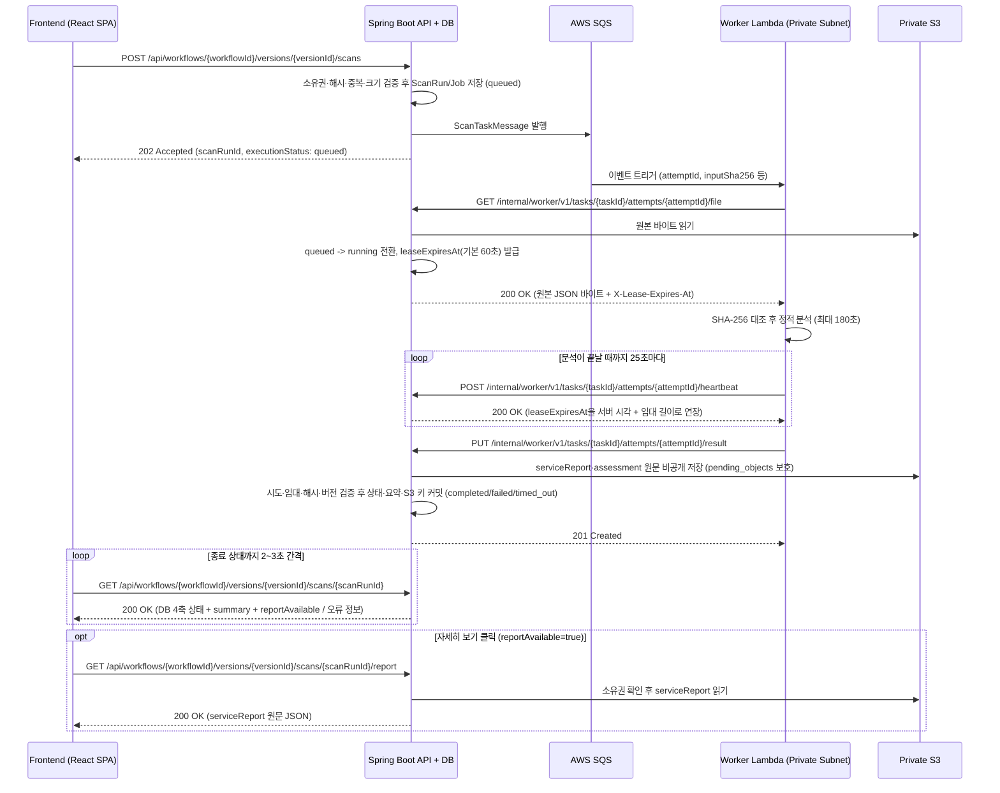
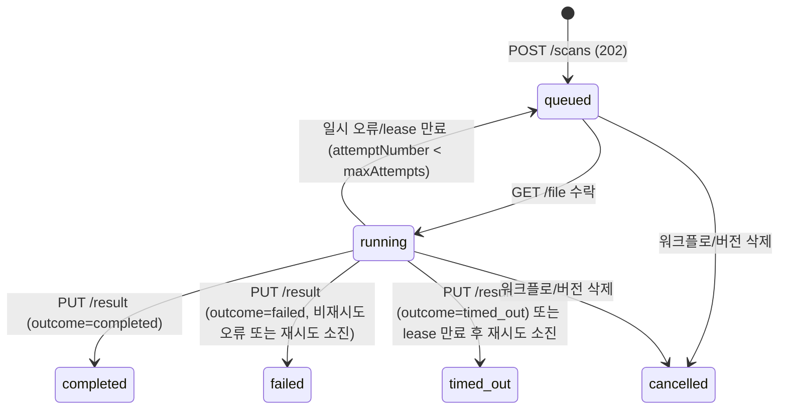

# 보안 검사 입력·출력·상태 API 계약

> 상태: [#39](https://github.com/serendipity-sec/workflow-hub/issues/39)에서 합의하고 [#57](https://github.com/serendipity-sec/workflow-hub/issues/57)에서 백엔드 HTTP API·DB(V9)·워커 내부 API·임대 회수를 구현한 공통 API 계약.
>
> 구현된 HTTP API의 단일 기준은 백엔드 컨트롤러의 OpenAPI 어노테이션(`/swagger-ui.html`, `/v3/api-docs`)이며 본 문서를 함께 동기화한다. 실제 AWS SQS/S3/Lambda 연동, 프론트엔드 검사 화면, 워커 Lambda 어댑터, 자동 검사 트리거, 온디맨드 LLM 설명 생성 API, 사용자 수동 취소 API, 버전 간 보안 비교 API는 별도 후속 이슈에서 진행한다.

## 1. 목적과 범위

백엔드(`backend/`), 프론트엔드(`frontend/`), 보안 워커(`worker/`)가 **같은 워크플로 버전과 원본 파일 바이트(SHA-256)** 를 기준으로 검사 요청, 진행 상태 조회, 작업 전달, 결과 제출을 일관되게 처리하도록 요청·응답·상태·오류 계약을 정의한다.

- **기준 워커 출력**: `worker/`의 통합 검사 진입점 `inspect` (`inspectionVersion: "1.1.0"` = `assessment 1.0.0` + `serviceReport 1.1.0`, [worker/docs/integration-handoff.md](../worker/docs/integration-handoff.md)).
- **`#14` 모의 계약과의 관계**: [worker/docs/contract.md](../worker/docs/contract.md)의 초기 SQL 단일 규칙 계약(`mock-once`, `POST /claim`, Presigned URL, 15초 lease)은 참고 자료로 검토했으며, 실제 서비스 계약은 본 문서를 따른다.
- **불변·안전 원칙**:
  - 업로드한 워크플로·Code 노드·표현식은 서버와 워커 모두에서 실행하지 않는다.
  - 검사 결과는 지원 범위 내 정적 분석 근거이며, 탐지 0건(`checked`)도 실제 실행 환경 전체의 안전성 보증으로 표시하지 않는다.
  - 원본 파일 본문, 인증 헤더, 원문 비밀정보는 로그와 오류 응답에 포함하지 않는다.

---

## 2. 아키텍처와 인증·보안 경계

### 2.1 작업 전달과 실행 흐름 (AWS 프리 티어 기준)

1차 서비스는 **AWS SQS + Private Subnet Lambda(Container Image) Push** 방식을 기본 실행 모델로 사용한다.



- **네트워크 경계**: Worker Lambda는 인터넷 출구(NAT Gateway)가 없는 Private Subnet에 배치하고, 백엔드 EC2의 VPC Private IP로만 `/internal/worker/v1/**`를 호출한다.
- **동시성 보호**: 단일 백엔드(`t3.micro`) 메모리·네트워크 보호를 위해 Lambda 동시 실행 상한(Reserved Concurrency, 권장 2~3)을 설정한다.
- **실행 환경 독립성**: 추후 EC2/ECS 상시 워커(Pull)로 전환하더라도 작업 식별자, `GET /file`, `POST /heartbeat`, `PUT /result` 계약은 그대로 유지한다.

### 2.2 인증 및 권한 분리

| 대상 경로                                | 인증 수단                                                        | 인가·차단 규칙                                                                                                                                                                                                                                                                                                                                                                   |
| :--------------------------------------- | :--------------------------------------------------------------- | :------------------------------------------------------------------------------------------------------------------------------------------------------------------------------------------------------------------------------------------------------------------------------------------------------------------------------------------------------------------------------- |
| 사용자 API (`/api/workflows/**`)         | Supabase 사용자 Access Token (`Authorization: Bearer <jwt>`)     | 백엔드가 비대칭 JWKS·issuer·audience·만료 검증 후 `sub`로 소유권 확인. 미인증은 `401`, 타인 소유·없는 ID·잘못된 UUID·삭제된 워크플로/버전은 모두 동일한 `404` 반환                                                                                                                                                                                                               |
| 워커 내부 API (`/internal/worker/v1/**`) | 서비스 전용 Bearer 토큰 (`Authorization: Bearer <worker-token>`) | 사용자 Supabase JWT와 완전히 분리된 자격 증명. 키 회전을 위해 복수 활성 토큰을 허용한다. 인증 스킴(`Bearer`)은 대소문자를 구분하지 않고 스킴 뒤 공백은 하나 이상 허용한다. 토큰에 공백·제어 문자가 있는 설정은 기동 시 거부한다. 토큰 누락·형식 오류·미일치는 `401`, 권한 없는 주체는 `403`. 외부 인터넷에서는 Security Group·리버스 프록시/WAF로 `/internal/**` 접근을 차단한다 |

### 2.3 공통 오류 응답 형식

모든 오류 응답은 기존 백엔드 [ApiError](../backend/src/main/java/dev/workflowhub/common/api/ApiError.java) 형식(`code`, `message`, `requestId`)과 `X-Request-Id` 응답 헤더를 따른다. 추가 문맥이 필요한 충돌 응답(예: `409 SCAN_ALREADY_IN_PROGRESS`)은 기존 백엔드 충돌 응답 관례에 따라 `details` 필드를 확장해 반환한다.

```json
{
  "code": "WORKFLOW_VERSION_NOT_FOUND",
  "message": "Workflow version not found",
  "requestId": "3f1c0f5e-52a8-4d2b-9a43-6b2f6f8f0c11"
}
```

---

## 3. 식별자 · 파일 해시 · 버전 연결 규칙

### 3.1 핵심 식별자

| 필드                | 형식                               | 소유·생성 주체                              | 역할                                                                                                               |
| :------------------ | :--------------------------------- | :------------------------------------------ | :----------------------------------------------------------------------------------------------------------------- |
| `scanRunId`         | UUID v4                            | 백엔드                                      | 특정 버전에 대한 보안 검사 실행 1건의 불변 식별자. 재검사 시 새 `scanRunId`를 발급하며 과거 결과를 덮어쓰지 않는다 |
| `taskId`            | UUID v4                            | 백엔드                                      | `ScanRun`에 연결된 비동기 작업(`AnalysisJob`) 식별자                                                               |
| `attemptId`         | UUID v4                            | 백엔드                                      | 작업의 단일 실행 시도 식별자. 재시도마다 새 `attemptId`를 발급해 지연·만료된 이전 시도의 결과 덮어쓰기를 막는다    |
| `workflowId`        | UUID v4                            | 백엔드                                      | 워크플로 식별자 (소유권 검증 기준)                                                                                 |
| `workflowVersionId` | UUID v4                            | 백엔드                                      | 검사 대상 불변 버전 식별자                                                                                         |
| `inputSha256`       | 소문자 hex 64자 (`^[0-9a-f]{64}$`) | 백엔드 (`workflow_versions.content_sha256`) | 서버가 S3에 저장한 원본 바이트의 SHA-256. 클라이언트 해시나 S3 ETag는 사용하지 않는다                              |

### 3.2 결과 계약 · 엔진 · 규칙 버전 연결

워커가 결과를 제출하면 검사 실행에 아래 버전 정보를 기록하고 조회 응답의 `versions`로 반환한다. 결과 제출 전(`queued`, `running`, 결과 없이 끝난 `cancelled`·`timed_out` 등)에는 `versions`가 `null`이므로 클라이언트는 `versions`가 있는지 먼저 확인한다.

```json
{
  "contractVersion": "1.0.0",
  "inspectionVersion": "1.1.0",
  "assessmentVersion": "1.0.0",
  "engineVersion": "0.10.0",
  "rulesVersion": "0.10.0",
  "adapterVersion": "n8n@2.48.7/workflow-json@1"
}
```

### 3.3 해시 누락 및 불일치 처리

1. **해시 누락 (`workflow_versions.content_sha256 == null`)**
   - 검사 요청(`POST .../scans`) 시 백엔드는 작업을 생성하지 않고 `409 VERSION_HASH_UNAVAILABLE`로 즉시 거절한다. 해시가 확인되지 않은 버전에는 검사 결과를 연결하지 않는다.
2. **워커 다운로드 시 해시 불일치**
   - 워커는 `GET /file`로 수신한 바이트의 SHA-256을 계산해 SQS 메시지의 `inputSha256`과 대조한다.
   - 불일치하면 분석기를 실행하지 않고 즉시 `PUT /result`에 `outcome: "failed"`, `error: { "code": "hash_mismatch", "retryable": false }`를 제출한다. `hash_mismatch`는 재시도하지 않는다.
3. **결과 제출 시 식별자·해시 불일치**
   - 백엔드는 모든 결과(`completed`·`failed`·`timed_out`)에서 `PUT /result` 본문의 공통 필드 `scanRunId`, `workflowVersionId`, `inputSha256`이 DB의 작업 기록과 일치하는지 검증한다.
   - `outcome: "completed"` 결과에서만 `inspection.inputSha256`, `inspection.assessment.inputSha256`, `inspection.serviceReport.inputSha256`, `inspection.llm.inputSha256`도 함께 검증한다. 실패·시간 초과 결과에는 `inspection`이 없다.
   - 하나라도 다르면 `409 RESULT_IDENTITY_MISMATCH`로 거절하고 결과를 저장하지 않는다.

### 3.4 입력 한도 차이 처리

현재 백엔드 업로드 한도(`5 MiB` / 깊이 64 / 노드 300 / 연결 1,500)와 워커 정적 분석 한도(`256 KiB` / 깊이 32 / 노드 128 / 연결 128)는 다르다.

- **파일 크기 초과 (`size_bytes > SCAN_MAX_FILE_BYTES`, 기본 `262144`)**: 검사 요청(`POST .../scans`) 시 백엔드가 `422 SCAN_FILE_TOO_LARGE`로 즉시 거절하고 `ScanRun`을 생성하지 않는다.
- **워커 구조 한도 초과 (깊이 > 32, 노드 > 128, 연결 > 128)**: 워커가 분석 단계에서 감지하고 `outcome: "failed"`, `error: { "code": "depth_limit" | "graph_limit", "retryable": false }`로 제출한다(재시도 안 함).

---

## 4. 4축 상태 모델과 전이 규칙

검사 실행 상태, 분석 범위, 정책 판단, 공개 상태를 서로 섞지 않고 4개 축으로 분리한다.

### 4.1 축별 정의

| 축               | 필드                                          | 허용 값                                                                                                                         | 의미                                                                                                                                                                             |
| :--------------- | :-------------------------------------------- | :------------------------------------------------------------------------------------------------------------------------------ | :------------------------------------------------------------------------------------------------------------------------------------------------------------------------------- |
| **1. 검사 실행** | `executionStatus`                             | `queued`, `running`, `completed`, `failed`, `timed_out`, `cancelled`                                                            | 비동기 검사 프로세스가 어디까지 수행됐는가                                                                                                                                       |
| **2. 분석 범위** | `analysisCoverage`                            | `checked`, `partial`, `unsupported`, `unknown`                                                                                  | 지원 프로파일 안에서 어디까지 확인했고 어디가 미확인인가                                                                                                                         |
| **3. 정책 판단** | `policy.evaluationStatus` / `policy.decision` | 처리 상태: `not_applicable`, `pending`, `completed`, `failed`<br/>판단 결과: `allow`, `review`, `block`, `inconclusive`, `null` | 서비스 정책 평가 처리 상태와 판단 결과. 1차 정책 엔진 미구현 단계에서는 `evaluationStatus: "not_applicable"`, `decision: null`이며 워커 참고 판정(`advisoryDecision`)과 구분한다 |
| **4. 공개 상태** | `publicationStatus`                           | `private`, `submitted`, `published`, `withdrawn`                                                                                | 선택한 버전의 배포 상태. 1차 기본값은 `private`                                                                                                                                  |

- **LLM 보조 설명 (`llm`)**: `status`는 `not_requested` · `generated` · `failed`를 사용한다. 1차 검사 시 Private Subnet Lambda는 외부 LLM을 호출하지 않으므로 검사 완료 시 기본값은 `not_requested`이며, 사용자가 원할 때 요청하는 온디맨드 생성 API는 후속 이슈에서 추가한다.

### 4.2 실행 상태 전이



- 종료 상태(`completed`, `failed`, `timed_out`, `cancelled`)에 도달한 `ScanRun`은 다른 상태로 전이하지 않는다.

### 4.3 프론트엔드 상태 구분 진리표

프론트엔드는 아래 조합을 기준으로 **탐지 0건 · 위험 발견 · 부분 분석/미지원 · 분석 실패 · 시간 초과 · 진행 중**을 명확히 구분한다.

| 화면 표시 구분                      | `executionStatus`    | `analysisCoverage`           | `summary.findingCount` | `summary.analysisGapCount`   | 화면 안내 원칙                                                                                   |
| :---------------------------------- | :------------------- | :--------------------------- | :--------------------- | :--------------------------- | :----------------------------------------------------------------------------------------------- |
| **대기 / 검사 중**                  | `queued` / `running` | `unknown`                    | `null`                 | `null`                       | 진행 표시 + 2~3초 간격 폴링 유지                                                                 |
| **탐지 0건 (지원 범위 완료)**       | `completed`          | `checked`                    | `0`                    | `0`                          | "지원 범위 내 탐지 0건" 표시. 단, `environmentChecks` 확인 안내 및 전체 안전성 보증 문구 금지    |
| **위험 후보 발견 (지원 범위 완료)** | `completed`          | `checked`                    | `>= 1`                 | `0`                          | `serviceReport.findings`의 위치·이유·조치 표시                                                   |
| **부분 분석 / 미지원 항목 있음**    | `completed`          | `partial` 또는 `unsupported` | `>= 0`                 | `>= 1` (또는 도구 일부 실패) | `analysisGaps`와 생략 건수(`omitted`)를 반드시 함께 표시. 탐지 0건이어도 문제 없음으로 표시 금지 |
| **분석 실패**                       | `failed`             | `unknown`                    | `null`                 | `null`                       | `error.code`와 사용자 안내 표시, 재검사 가능 여부 안내                                           |
| **시간 초과**                       | `timed_out`          | `unknown`                    | `null`                 | `null`                       | 분석 시간 초과 또는 워커 응답 만료 안내, 재검사 버튼 제공                                        |
| **취소됨**                          | `cancelled`          | `unknown`                    | `null`                 | `null`                       | 버전/워크플로 삭제 등으로 중단됨 표시                                                            |

- **매핑 규칙 (`worker` → `analysisCoverage`)**:
  - `executionStatus != "completed"` → `unknown`
  - `executionStatus == "completed"`이고 `assessment.status == "analyzed"`이며 `serviceReport.executionStatus == "completed"`이고 `serviceReport.counts.analysisGaps == 0` → `checked`
  - `executionStatus == "completed"`이고 `assessment.status == "unsupported"` → `unsupported`
  - 그 외 `executionStatus == "completed"` (예: `assessment.status == "partial"`, `analysisGaps >= 1`, 또는 도구 일부 실패 `completed_with_errors`) → `partial`

---

## 5. 사용자 API 계약 (Frontend ↔ Backend)

모든 경로는 `application/json`을 반환하며 Supabase 사용자 Bearer JWT가 필수다.

### 5.1 보안 검사 요청

- `POST /api/workflows/{workflowId}/versions/{versionId}/scans`
- **헤더**:
  - `Authorization: Bearer <supabase-access-token>` (필수)
  - `Idempotency-Key: <string>` (선택, 최대 128자 — 네트워크 재시도 시 동일 `scanRunId` 반환용)
- **요청 본문**: 없음(또는 빈 객체 `{}`)
- **응답**:
  - `202 Accepted`: 새 `ScanRun`을 저장해 보존했다(또는 동일 `Idempotency-Key` 재시도에 같은 `scanRunId`). SQS 발행 완료를 보장하지 않는다. 발행 결과를 알 수 없는 실패(시간 초과·연결 끊김·SQS 5xx)이면 실행을 `queued`로 두고 `202`를 반환하며, 회수기가 같은 `attemptId`로 다시 발행한다
  - `400 INVALID_IDEMPOTENCY_KEY`: `Idempotency-Key` 형식 오류(공백·128자 초과 등)
  - `401 UNAUTHORIZED`: 토큰 없음·유효하지 않음
  - `404 WORKFLOW_VERSION_NOT_FOUND`: 타인 소유·존재하지 않는 워크플로/버전·삭제된 항목·잘못된 UUID
  - `409 VERSION_HASH_UNAVAILABLE`: 대상 버전의 `content_sha256`이 기록되지 않음(`null`)
  - `409 SCAN_ALREADY_IN_PROGRESS`: 같은 버전에 이미 `queued` 또는 `running` 상태인 검사가 있음. 오류 응답의 `details`에 진행 중인 `scanRunId`와 `executionStatus`를 함께 반환한다.
  - `409 IDEMPOTENCY_KEY_CONFLICT`: 같은 `Idempotency-Key`를 다른 버전에 재사용함
  - `422 SCAN_FILE_TOO_LARGE`: 원본 파일 크기가 검사 파일 크기 한도(`SCAN_MAX_FILE_BYTES`, 기본 256 KiB)를 초과함
  - `503 SCAN_DISPATCH_UNAVAILABLE`: SQS가 최초 발행을 명확히 거부했다(4xx 서비스 오류: 권한·큐 없음·스로틀링 등, 메시지가 들어가지 않았음이 확실). SDK가 같은 호출 안에서 재시도한 뒤의 4xx는 앞선 시도가 메시지를 넣었을 수 있으므로 결과 불명으로 본다. 실행은 지우지 않고 `failed`(`error.code = "scan_dispatch_failed"`, `retryable: false`는 서버가 이 실행을 다시 시도하지 않는다는 뜻)로 마감하며 멱등성 키는 해제한다. 잠시 뒤 같은 키나 새 키로 다시 요청하면 새 검사가 만들어진다. 워커가 이미 시작했거나 회수기가 발행을 넘겨받은 실행은 마감하지 않고 `202`로 현재 상태를 반환한다(그사이 삭제로 취소됐으면 `404`). 같은 키의 최초 요청이 아직 첫 발행 결과를 기다리는 동안의 재전송도 이 코드로 거절한다. 그 실행은 곧 `failed`로 마감될 수 있기 때문이며, 실행은 지우지 않으므로 잠시 뒤 같은 키로 다시 요청하면 정해진 결과를 받는다

### 5.2 버전별 검사 이력 목록 조회

- `GET /api/workflows/{workflowId}/versions/{versionId}/scans?limit=20&cursor=<opaque>`
- **쿼리 파라미터**: 기존 워크플로 목록과 동일한 커서 페이지네이션(`limit` 기본 20, 1~100, `createdAt DESC, scanRunId DESC`).
- **응답**:
  - `200 OK`: `{ "data": { "items": [ScanRunData...], "nextCursor": string | null } }` (DB의 4축 상태·요약·`reportAvailable`·오류만 반환, S3 호출 없음)
  - `400 INVALID_LIMIT` / `INVALID_CURSOR`, `401`, `404 WORKFLOW_VERSION_NOT_FOUND`

### 5.3 버전 최신 검사 단건 조회

- `GET /api/workflows/{workflowId}/versions/{versionId}/scans/latest`
- **용도**: 상세 화면 진입 시 선택한 버전의 가장 최근 검사 상태·요약을 한 번의 요청으로 조회한다(DB만 조회, S3 호출 없음).
- **응답**:
  - `200 OK`: `{ "data": ScanRunData | null }` — 아직 검사 이력이 없는 살아 있는 버전은 `200 OK`와 `{ "data": null }`을 반환한다.
  - `401 UNAUTHORIZED`
  - `404 WORKFLOW_VERSION_NOT_FOUND`: 타인 소유·존재하지 않는 워크플로/버전·삭제된 항목·잘못된 UUID

### 5.4 검사 상태 및 요약 단건 조회 (폴링 대상)

- `GET /api/workflows/{workflowId}/versions/{versionId}/scans/{scanRunId}`
- **프론트 폴링 규칙**: `executionStatus`가 `queued` 또는 `running`이면 **2~3초 간격**으로 재조회하고, 종료 상태(`completed`, `failed`, `timed_out`, `cancelled`)에 도달하면 폴링을 중단한다.
- **응답**:
  - `200 OK`: `ScanRunData` (4축 상태, 버전·해시 정보, DB 요약 `summary`, `reportAvailable`, 실패/시간 초과 시 `error`, `llm` 상태 포함 — S3 호출 없음).
  - `401 UNAUTHORIZED`
  - `404 SCAN_RUN_NOT_FOUND`: 타인 소유·존재하지 않는 워크플로/버전/검사·서로 다른 버전과 `scanRunId` 조합·삭제된 항목

### 5.5 완료된 검사의 상세 리포트 조회 (`serviceReport`, 지연 조회)

- `GET /api/workflows/{workflowId}/versions/{versionId}/scans/{scanRunId}/report`
- **용도**: 사용자가 "자세히 보기"를 열 때(`reportAvailable == true`) 백엔드가 소유권을 검증한 뒤 DB의 비공개 S3 키로 `serviceReport` 원문을 읽어 반환한다. S3 버킷·키·직접 URL은 브라우저에 노출하지 않는다.
- **참고**: `assessment` 원문(최대 ~2 MiB)도 별도 비공개 S3 객체에 보관해 향후 비교·재검사·온디맨드 LLM·감사에 사용한다.
- **응답**:
  - `200 OK`: `{ "data": { "scanRunId", "workflowId", "workflowVersionId", "versionLabel", "inputSha256", "versions", "serviceReport" } }`
  - `401 UNAUTHORIZED`
  - `404 SCAN_RUN_NOT_FOUND`
  - `409 SCAN_REPORT_NOT_AVAILABLE`: 아직 완료되지 않았거나 저장된 리포트가 없음
  - `503 STORAGE_UNAVAILABLE`: 비공개 S3 읽기 일시 실패

---

## 6. 워커 내부 API 및 작업 메시지 계약 (Backend ↔ Worker)

### 6.1 SQS 작업 메시지 (`ScanTaskMessage`)

백엔드가 `ScanRun`과 `AnalysisJob`을 DB에 커밋한 뒤 SQS에 발행하는 JSON 메시지다.

```json
{
  "contractVersion": "1.0.0",
  "taskId": "8a1b2c3d-4e5f-4a6b-8c7d-9e0f1a2b3c4d",
  "attemptId": "11111111-2222-4333-8444-555555555555",
  "scanRunId": "9f8e7d6c-5b4a-4321-9876-543210fedcba",
  "workflowVersionId": "5d2f7c1a-8b3e-4c6d-a1f0-9e4b2c7d8a33",
  "inputSha256": "a1b2c3d4e5f60718293a4b5c6d7e8f90123456789abcdef0123456789abcdef0",
  "sizeBytes": 1842,
  "attemptNumber": 1,
  "maxAttempts": 3,
  "enqueuedAt": "2026-11-29T00:10:00Z"
}
```

### 6.2 원본 파일 다운로드 및 실행 시작 (`GET /file`)

- `GET /internal/worker/v1/tasks/{taskId}/attempts/{attemptId}/file`
- **헤더**: `Authorization: Bearer <worker-service-token>` (필수)
- **동작**:
  1. 백엔드가 `taskId`/`attemptId` 유효성, 워크플로·버전 삭제 여부, 현재 상태를 확인한다.
  2. `queued` 상태이면 한 트랜잭션에서 `running`으로 전환하고 `started_at = now()`, `lease_expires_at = now() + 임대 길이`(`SCAN_LEASE_DURATION`, 기본 60초)를 기록한다. 임대 길이는 설정에 따라 다르므로 워커는 `X-Lease-Expires-At`을 기준으로 판단한다.
  3. S3에서 원본 바이트를 읽어 `application/json` 본문으로 그대로 반환한다.
- **응답 헤더**:
  - `X-Input-Sha256`: 기대 SHA-256 (64자 hex)
  - `X-Lease-Expires-At`: UTC ISO-8601 만료 시각 (예: `2026-11-29T00:11:01Z`)
- **상태 코드**:
  - `200 OK`: 원본 JSON 바이트
  - `401 WORKER_UNAUTHORIZED` / `403 WORKER_FORBIDDEN`: 유효하지 않은 워커 토큰
  - `404 TASK_ATTEMPT_NOT_FOUND`: 없는 작업/시도
  - `409 TASK_CANCELLED` / `TASK_NOT_RUNNABLE`: 워크플로·버전 삭제 등으로 취소되었거나 이미 실행 불가능한 상태의 작업
  - `410 ATTEMPT_EXPIRED`: 이미 만료되었거나 새 시도로 대체된 `attemptId`
  - `503 STORAGE_UNAVAILABLE`: S3 읽기 일시 실패
- **HEAD**: 상태를 바꾸는 요청이므로 `HEAD /file`은 시도를 시작하지 않고 `405 METHOD_NOT_ALLOWED`(`Allow: GET`)로 거절한다.

### 6.3 임대 연장 (`POST /heartbeat`)

- `POST /internal/worker/v1/tasks/{taskId}/attempts/{attemptId}/heartbeat`
- **헤더**: `Authorization: Bearer <worker-service-token>` (필수)
- **호출 주기**: 워커는 `GET /file` 이후 분석이 계속되는 동안 **25초 간격**으로 호출한다(기본 임대 60초 기준). 서버는 매번 서버 시각 + 임대 길이로 연장하고 응답의 `leaseExpiresAt`을 기준으로 삼는다. 임대 유효성은 작업 잠금을 얻은 뒤의 DB 시각으로 판정하므로, 잠금을 기다리는 사이 만료된 임대는 연장하지 않고 `410`으로 거절한다. `409` 또는 `410`을 받으면 진행 중인 분석을 `AbortSignal`로 즉시 중단한다.
- **응답**:
  - `200 OK`: `{ "data": { "taskId": "...", "attemptId": "...", "leaseExpiresAt": "2026-11-29T00:11:26Z" } }`
  - `401` / `403`: 워커 인증 실패
  - `409 TASK_CANCELLED` / `ATTEMPT_NOT_ACTIVE`: 버전 삭제·취소 또는 이미 종료된 작업
  - `410 ATTEMPT_EXPIRED`: 임대가 이미 만료됨

### 6.4 검사 결과 제출 (`PUT /result`)

- `PUT /internal/worker/v1/tasks/{taskId}/attempts/{attemptId}/result`
- **헤더**:
  - `Authorization: Bearer <worker-service-token>` (필수)
  - `Content-Type: application/json` (공백 없는 직렬화 권장, 최대 `SCAN_MAX_RESULT_BYTES`, 기본 `6 MiB`)
  - `Idempotency-Key: <sha256-of-raw-request-body>` (필수, 소문자 hex 64자)
- **요청 본문 공통 필드**:
  - `contractVersion`, `taskId`, `attemptId`, `scanRunId`, `workflowVersionId`, `inputSha256`, `versions`
  - `outcome`: `"completed"` | `"failed"` | `"timed_out"`
  - `outcome == "completed"`일 때: `inspection` (`inspectionVersion: "1.1.0"`, `inputSha256`, `assessment`, `serviceReport`, `llm: { status: "unavailable", code: "disabled", ... }`) 필수
  - `outcome == "failed"` 또는 `"timed_out"`일 때: `error` (`{ code, retryable, location? }`) 필수
- **상태 코드**:
  - `201 Created`: 최초 결과 수락·저장 완료 (응답 본문 `{ "data": { "scanRunId": "...", "executionStatus": "...", "analysisCoverage": "..." } }`)
  - `200 OK`: 이미 수락한 동일 제출(`Idempotency-Key` 일치)의 멱등 재전송
  - `400 BAD_REQUEST` / `422 INVALID_RESULT`: 필수 헤더·스키마 위반
  - `401 WORKER_UNAUTHORIZED` / `403 WORKER_FORBIDDEN`: 워커 인증 실패
  - `404 TASK_ATTEMPT_NOT_FOUND`: 존재하지 않는 작업/시도
  - `409 RESULT_IDENTITY_MISMATCH` / `IDEMPOTENCY_KEY_CONFLICT` / `TASK_CANCELLED` / `ATTEMPT_NOT_ACTIVE`: 해시·버전·실행 ID 불일치, 같은 시도에서 다른 본문 재제출, 작업이 취소/삭제됨, 또는 실행 중이 아닌 시도
  - `410 ATTEMPT_EXPIRED`: 서버/DB 시각 기준 `leaseExpiresAt` 만료 또는 이미 새 시도로 대체된 지연 결과
  - `413 PAYLOAD_TOO_LARGE`: 결과 본문이 최대 크기(`SCAN_MAX_RESULT_BYTES`, 기본 `6 MiB`)를 초과함
  - `415 UNSUPPORTED_MEDIA_TYPE`: `Content-Type`이 `application/json`이 아님
  - `429` / `502` / `503` / `504`: 일시적 서버 오류 (워커가 lease 이내에 같은 바이트·같은 `Idempotency-Key`로 재전송 가능)

---

## 7. 임대 · 재시도 · 중복 · 지연 · 삭제 처리 기준

| 항목                           | 확정 규칙                                                                                                                                                                                                                                                                                                                                                                                                                                                                                                                                                                                                                                                                                                                                                |
| :----------------------------- | :------------------------------------------------------------------------------------------------------------------------------------------------------------------------------------------------------------------------------------------------------------------------------------------------------------------------------------------------------------------------------------------------------------------------------------------------------------------------------------------------------------------------------------------------------------------------------------------------------------------------------------------------------------------------------------------------------------------------------------------------------- |
| **임대(Lease)**                | `GET /file` 시 임대 길이(`SCAN_LEASE_DURATION`, 기본 `60초`) 부여, `POST /heartbeat`(25초 간격)로 매회 `now() + 임대 길이` 연장. 모든 만료 판정은 작업 잠금을 얻은 뒤의 서버/DB 시각 기준이며, 워커는 응답의 만료 시각을 기준으로 삼는다                                                                                                                                                                                                                                                                                                                                                                                                                                                                                                                 |
| **최대 시도 횟수**             | 총 `3회` (최초 `1` + 재시도 `2`)                                                                                                                                                                                                                                                                                                                                                                                                                                                                                                                                                                                                                                                                                                                         |
| **재시도 대상 오류**           | 임대 만료(워커 무응답/강제 종료), `sandbox_unavailable`, `sandbox_failed`, `file_access`, 일시적 네트워크/스토리지 오류 (`retryable: true`)                                                                                                                                                                                                                                                                                                                                                                                                                                                                                                                                                                                                              |
| **비재시도 오류 (즉시 종료)**  | `hash_mismatch`, `file_too_large`, `invalid_utf8`, `invalid_json`, `duplicate_key`, `depth_limit`, `graph_limit`, `invalid_workflow`, `identity_collision`, `broken_connection`, `assessment_output_limit`, `invalid_configuration`, `cancelled` (`retryable: false`). `assessment_timeout`은 180초 분석 한도 초과이므로 즉시 `timed_out`으로 종료한다                                                                                                                                                                                                                                                                                                                                                                                                   |
| **만료·지연 결과**             | `leaseExpiresAt` 경과 후 도착한 결과는 재시도 배정 전이라도 `410 ATTEMPT_EXPIRED`로 거절한다. 새 시도가 생성된 뒤 이전 시도의 결과도 `410`으로 거절해 최신 상태를 덮어쓰지 못하게 한다                                                                                                                                                                                                                                                                                                                                                                                                                                                                                                                                                                   |
| **중복 제출 (멱등성)**         | 이미 수락된 `attemptId`에 동일한 `Idempotency-Key`(본문 SHA-256)로 재전송되면 결과·정책을 다시 적용하지 않고 최초 수락 응답과 같은 `200 OK`를 반환한다. 동시에 들어온 같은 제출도 작업 잠금을 얻은 뒤 시도 상태를 다시 읽어 같은 응답을 받는다. 재시도 발행이 실패해도 수락 응답은 바꾸지 않는다. 다른 `Idempotency-Key`로 재전송되면 `409 IDEMPOTENCY_KEY_CONFLICT`로 거절한다                                                                                                                                                                                                                                                                                                                                                                          |
| **워크플로/버전 삭제 중 실행** | 소유자가 워크플로 또는 버전을 삭제하면 백엔드가 같은 트랜잭션에서 진행 중(`queued`/`running`) 작업을 `cancelled`로 표시한다. 이후 워커의 `GET /file`, `POST /heartbeat`, `PUT /result`는 `409 TASK_CANCELLED`로 거절한다                                                                                                                                                                                                                                                                                                                                                                                                                                                                                                                                 |
| **백엔드 만료 회수**           | 백엔드 스케줄러가 `running` 상태에서 `lease_expires_at < now()`인 작업과 `SCAN_QUEUED_TIMEOUT`(기본 5분) 동안 시작되지 않은 `queued` 작업을 감지해 `attemptNumber < maxAttempts`이면 새 `attemptId`로 `queued` 재발행하고, 소진 시 `timed_out`으로 마감한다. SQS DLQ에 도달한 메시지도 동일 규칙으로 회수한다                                                                                                                                                                                                                                                                                                                                                                                                                                            |
| **발행 실패 재발행**           | 최초 검사 요청의 발행을 SQS가 명확히 거부한 경우만 실행을 `failed`(`scan_dispatch_failed`)로 마감한다(5.1절). 그 밖의 발행 실패(결과 불명, 회수기·워커 재시도 발행 실패)는 검사를 끝내지 않는다. 발행이 확인되지 않은 `queued` 시도는 `SCAN_DISPATCH_RETRY_DELAY`(기본 1분, `SQS_CALL_TIMEOUT`보다 길고 `SCAN_QUEUED_TIMEOUT`보다 짧아야 함) 뒤 같은 `attemptId`로 다시 발행한다. 미수신 만료는 발행이 확인된 시도면 실제 발행 시각부터 `SCAN_QUEUED_TIMEOUT`이 지난 뒤, 확인되지 않은 시도면 같은 `attemptId` 재발행을 한 번 이상 시도하고 그 뒤 재발행 간격이 더 지난 뒤에만 적용한다. 장애가 길어지면 시도 횟수를 소모해 결국 `timed_out`(`queue_timeout`)으로 마감한다. 같은 시도가 두 번 전달되면 두 번째 `GET /file`은 `409 TASK_NOT_RUNNABLE`이다 |

---

## 8. 합성 요청·응답 예시

모든 예시는 실제 사용자 데이터·토큰·비밀키를 포함하지 않는 **합성 데이터**다. `inspection`·`assessment`·`serviceReport`·`llm` 예시는 가독성을 위해 핵심 필드만 발췌했으며, 실제 워커 페이로드 전체 구조는 [worker/src/service/inspection.ts](../worker/src/service/inspection.ts)와 [worker/src/contracts/assessment-contract.ts](../worker/src/contracts/assessment-contract.ts)의 strict 스키마를 따른다.

### 시나리오 1: 정상 완료 — 탐지 0건 (`completed` + `checked`)

#### 1-1. 프론트 → 백엔드: 검사 요청

```http
POST /api/workflows/0b6a8d7e-2f4c-4e0a-9a43-1d1f5c3e7a10/versions/5d2f7c1a-8b3e-4c6d-a1f0-9e4b2c7d8a33/scans
Authorization: Bearer <supabase-access-token>
Idempotency-Key: scan-req-0001
```

응답 (`202 Accepted`):

```json
{
  "data": {
    "scanRunId": "9f8e7d6c-5b4a-4321-9876-543210fedcba",
    "workflowId": "0b6a8d7e-2f4c-4e0a-9a43-1d1f5c3e7a10",
    "workflowVersionId": "5d2f7c1a-8b3e-4c6d-a1f0-9e4b2c7d8a33",
    "versionLabel": "v1",
    "inputSha256": "a1b2c3d4e5f60718293a4b5c6d7e8f90123456789abcdef0123456789abcdef0",
    "versions": null,
    "executionStatus": "queued",
    "analysisCoverage": "unknown",
    "policy": {
      "evaluationStatus": "not_applicable",
      "decision": null,
      "advisoryDecision": null
    },
    "publicationStatus": "private",
    "llm": {
      "status": "not_requested"
    },
    "summary": null,
    "reportAvailable": false,
    "error": null,
    "createdAt": "2026-11-29T00:10:00Z",
    "startedAt": null,
    "finishedAt": null
  }
}
```

#### 1-2. 워커 → 백엔드: 결과 제출 (`PUT /result`)

```http
PUT /internal/worker/v1/tasks/8a1b2c3d-4e5f-4a6b-8c7d-9e0f1a2b3c4d/attempts/11111111-2222-4333-8444-555555555555/result
Authorization: Bearer <worker-service-token>
Content-Type: application/json
Idempotency-Key: <sha256-of-raw-request-body>
```

```json
{
  "contractVersion": "1.0.0",
  "taskId": "8a1b2c3d-4e5f-4a6b-8c7d-9e0f1a2b3c4d",
  "attemptId": "11111111-2222-4333-8444-555555555555",
  "scanRunId": "9f8e7d6c-5b4a-4321-9876-543210fedcba",
  "workflowVersionId": "5d2f7c1a-8b3e-4c6d-a1f0-9e4b2c7d8a33",
  "inputSha256": "a1b2c3d4e5f60718293a4b5c6d7e8f90123456789abcdef0123456789abcdef0",
  "versions": {
    "contractVersion": "1.0.0",
    "inspectionVersion": "1.1.0",
    "assessmentVersion": "1.0.0",
    "engineVersion": "0.10.0",
    "rulesVersion": "0.10.0",
    "adapterVersion": "n8n@2.48.7/workflow-json@1"
  },
  "outcome": "completed",
  "inspection": {
    "inspectionVersion": "1.1.0",
    "inputSha256": "a1b2c3d4e5f60718293a4b5c6d7e8f90123456789abcdef0123456789abcdef0",
    "assessment": {
      "assessmentVersion": "1.0.0",
      "engineVersion": "0.10.0",
      "inputSha256": "a1b2c3d4e5f60718293a4b5c6d7e8f90123456789abcdef0123456789abcdef0",
      "execution": "not_run",
      "status": "analyzed",
      "decision": "allow"
    },
    "serviceReport": {
      "serviceReportVersion": "1.1.0",
      "inputSha256": "a1b2c3d4e5f60718293a4b5c6d7e8f90123456789abcdef0123456789abcdef0",
      "executionStatus": "completed",
      "analysisStatus": "complete",
      "assessmentStatus": "analyzed",
      "staticCoverageStatus": "within_supported_profile",
      "decision": "allow",
      "headline": "지원 범위의 검사 결과와 사용 조건을 확인하세요",
      "counts": {
        "findings": 0,
        "observations": 0,
        "analysisGaps": 0,
        "environmentChecks": 1,
        "scopeNotes": 0
      },
      "omitted": {
        "findings": 0,
        "observations": 0,
        "analysisGaps": 0,
        "environmentChecks": 0,
        "scopeNotes": 0
      },
      "serviceScope": {
        "highRiskFindingCount": 0,
        "sinkReachableGapCount": 0,
        "isolatedGapCount": 0,
        "usageNoticeCount": 1,
        "excludedScopeNoticeCount": 0,
        "securityReviewRequired": false
      },
      "findings": [],
      "analysisGaps": [],
      "environmentChecks": [
        {
          "id": "env-check-01",
          "code": "database_runtime_schema_and_permissions_unverified",
          "title": "실제 실행 권한 확인",
          "explanation": "JSON 설정만으로 실제 DB 권한과 실행 영향을 확인할 수 없습니다.",
          "action": "운영자가 실행 계정의 최소 권한을 확인하세요."
        }
      ],
      "scopeNotes": [],
      "truncated": false
    },
    "llm": {
      "status": "unavailable",
      "code": "disabled",
      "inputSha256": "a1b2c3d4e5f60718293a4b5c6d7e8f90123456789abcdef0123456789abcdef0"
    }
  }
}
```

#### 1-3. 프론트 → 백엔드: 완료 상태·요약 조회 (`GET /scans/{scanRunId}`, `200 OK`)

```json
{
  "data": {
    "scanRunId": "9f8e7d6c-5b4a-4321-9876-543210fedcba",
    "workflowId": "0b6a8d7e-2f4c-4e0a-9a43-1d1f5c3e7a10",
    "workflowVersionId": "5d2f7c1a-8b3e-4c6d-a1f0-9e4b2c7d8a33",
    "versionLabel": "v1",
    "inputSha256": "a1b2c3d4e5f60718293a4b5c6d7e8f90123456789abcdef0123456789abcdef0",
    "versions": {
      "contractVersion": "1.0.0",
      "inspectionVersion": "1.1.0",
      "assessmentVersion": "1.0.0",
      "engineVersion": "0.10.0",
      "rulesVersion": "0.10.0",
      "adapterVersion": "n8n@2.48.7/workflow-json@1"
    },
    "executionStatus": "completed",
    "analysisCoverage": "checked",
    "policy": {
      "evaluationStatus": "not_applicable",
      "decision": null,
      "advisoryDecision": "allow"
    },
    "publicationStatus": "private",
    "llm": {
      "status": "not_requested"
    },
    "summary": {
      "headline": "지원 범위의 검사 결과와 사용 조건을 확인하세요",
      "analysisStatus": "complete",
      "findingCount": 0,
      "highRiskFindingCount": 0,
      "observationCount": 0,
      "analysisGapCount": 0,
      "sinkReachableGapCount": 0,
      "environmentCheckCount": 1,
      "securityReviewRequired": false
    },
    "reportAvailable": true,
    "error": null,
    "createdAt": "2026-11-29T00:10:00Z",
    "startedAt": "2026-11-29T00:10:01Z",
    "finishedAt": "2026-11-29T00:10:05Z"
  }
}
```

#### 1-4. 프론트 → 백엔드: 상세 리포트 지연 조회 (`GET /scans/{scanRunId}/report`, `200 OK`)

```json
{
  "data": {
    "scanRunId": "9f8e7d6c-5b4a-4321-9876-543210fedcba",
    "workflowId": "0b6a8d7e-2f4c-4e0a-9a43-1d1f5c3e7a10",
    "workflowVersionId": "5d2f7c1a-8b3e-4c6d-a1f0-9e4b2c7d8a33",
    "versionLabel": "v1",
    "inputSha256": "a1b2c3d4e5f60718293a4b5c6d7e8f90123456789abcdef0123456789abcdef0",
    "versions": {
      "contractVersion": "1.0.0",
      "inspectionVersion": "1.1.0",
      "assessmentVersion": "1.0.0",
      "engineVersion": "0.10.0",
      "rulesVersion": "0.10.0",
      "adapterVersion": "n8n@2.48.7/workflow-json@1"
    },
    "serviceReport": {
      "serviceReportVersion": "1.1.0",
      "executionStatus": "completed",
      "analysisStatus": "complete",
      "findings": [],
      "analysisGaps": [],
      "environmentChecks": [
        {
          "id": "env-check-01",
          "code": "database_runtime_schema_and_permissions_unverified",
          "title": "실제 실행 권한 확인",
          "explanation": "JSON 설정만으로 실제 DB 권한과 실행 영향을 확인할 수 없습니다.",
          "action": "운영자가 실행 계정의 최소 권한을 확인하세요."
        }
      ],
      "scopeNotes": [],
      "truncated": false
    }
  }
}
```

---

### 시나리오 2: 부분 분석 / 미지원 항목 포함 (`completed` + `partial`)

탐지가 0건이더라도 `analysisGaps`가 존재하면 `analysisCoverage`는 `"partial"`, `securityReviewRequired`는 `true`로 반환해 프론트가 "안전"으로 오인하지 않게 한다. 상세 카드(`findings`, `analysisGaps` 등)는 `GET /scans/{scanRunId}/report`로 조회한다.

```json
{
  "data": {
    "scanRunId": "22222222-3333-4444-8555-666666666666",
    "workflowId": "0b6a8d7e-2f4c-4e0a-9a43-1d1f5c3e7a10",
    "workflowVersionId": "6e3a8d2b-9c4f-4d7e-b2a1-0f5c3d8e9b44",
    "versionLabel": "v1.1",
    "inputSha256": "b2c3d4e5f60718293a4b5c6d7e8f90123456789abcdef0123456789abcdef012",
    "versions": {
      "contractVersion": "1.0.0",
      "inspectionVersion": "1.1.0",
      "assessmentVersion": "1.0.0",
      "engineVersion": "0.10.0",
      "rulesVersion": "0.10.0",
      "adapterVersion": "n8n@2.48.7/workflow-json@1"
    },
    "executionStatus": "completed",
    "analysisCoverage": "partial",
    "policy": {
      "evaluationStatus": "not_applicable",
      "decision": null,
      "advisoryDecision": "inconclusive"
    },
    "publicationStatus": "private",
    "llm": {
      "status": "not_requested"
    },
    "summary": {
      "headline": "검사 결과와 분석하지 못한 위치를 확인하세요",
      "analysisStatus": "review_required",
      "findingCount": 1,
      "highRiskFindingCount": 1,
      "observationCount": 0,
      "analysisGapCount": 1,
      "sinkReachableGapCount": 1,
      "environmentCheckCount": 0,
      "securityReviewRequired": true
    },
    "reportAvailable": true,
    "error": null,
    "createdAt": "2026-11-29T00:15:00Z",
    "startedAt": "2026-11-29T00:15:01Z",
    "finishedAt": "2026-11-29T00:15:08Z"
  }
}
```

---

### 시나리오 3: 분석 실패 (`failed` + `unknown`)

#### 3-1. 워커 → 백엔드: 해시 불일치 실패 제출 (`PUT /result`)

```json
{
  "contractVersion": "1.0.0",
  "taskId": "aaaaaaaa-bbbb-4ccc-8ddd-eeeeeeeeeeee",
  "attemptId": "bbbbbbbb-cccc-4ddd-8eee-ffffffffffff",
  "scanRunId": "33333333-4444-4555-8666-777777777777",
  "workflowVersionId": "5d2f7c1a-8b3e-4c6d-a1f0-9e4b2c7d8a33",
  "inputSha256": "a1b2c3d4e5f60718293a4b5c6d7e8f90123456789abcdef0123456789abcdef0",
  "versions": {
    "contractVersion": "1.0.0",
    "inspectionVersion": "1.1.0",
    "assessmentVersion": "1.0.0",
    "engineVersion": "0.10.0",
    "rulesVersion": "0.10.0",
    "adapterVersion": "n8n@2.48.7/workflow-json@1"
  },
  "outcome": "failed",
  "error": {
    "code": "hash_mismatch",
    "retryable": false
  }
}
```

#### 3-2. 프론트 → 백엔드: 실패 조회 응답 (`200 OK`)

```json
{
  "data": {
    "scanRunId": "33333333-4444-4555-8666-777777777777",
    "workflowId": "0b6a8d7e-2f4c-4e0a-9a43-1d1f5c3e7a10",
    "workflowVersionId": "5d2f7c1a-8b3e-4c6d-a1f0-9e4b2c7d8a33",
    "versionLabel": "v1",
    "inputSha256": "a1b2c3d4e5f60718293a4b5c6d7e8f90123456789abcdef0123456789abcdef0",
    "versions": {
      "contractVersion": "1.0.0",
      "inspectionVersion": "1.1.0",
      "assessmentVersion": "1.0.0",
      "engineVersion": "0.10.0",
      "rulesVersion": "0.10.0",
      "adapterVersion": "n8n@2.48.7/workflow-json@1"
    },
    "executionStatus": "failed",
    "analysisCoverage": "unknown",
    "policy": {
      "evaluationStatus": "not_applicable",
      "decision": null,
      "advisoryDecision": null
    },
    "publicationStatus": "private",
    "llm": {
      "status": "not_requested"
    },
    "summary": null,
    "reportAvailable": false,
    "error": {
      "code": "hash_mismatch",
      "message": "Downloaded workflow bytes did not match the recorded version SHA-256",
      "retryable": false
    },
    "createdAt": "2026-11-29T00:20:00Z",
    "startedAt": "2026-11-29T00:20:01Z",
    "finishedAt": "2026-11-29T00:20:02Z"
  }
}
```

---

### 시나리오 4: 시간 초과 (`timed_out` + `unknown`)

워커가 180초 분석 제한에 도달해 `outcome: "timed_out"`, `error.code: "assessment_timeout"`을 제출하거나, 임대 만료 후 재시도 3회를 모두 소진해 백엔드가 `timed_out`으로 마감한 경우의 프론트 조회 응답이다.

```json
{
  "data": {
    "scanRunId": "44444444-5555-4666-8777-888888888888",
    "workflowId": "0b6a8d7e-2f4c-4e0a-9a43-1d1f5c3e7a10",
    "workflowVersionId": "7f4b9e3c-0d5a-4e8f-83b2-1a6d4e9f0c55",
    "versionLabel": "v1.2",
    "inputSha256": "c3d4e5f60718293a4b5c6d7e8f90123456789abcdef0123456789abcdef01234",
    "versions": {
      "contractVersion": "1.0.0",
      "inspectionVersion": "1.1.0",
      "assessmentVersion": "1.0.0",
      "engineVersion": "0.10.0",
      "rulesVersion": "0.10.0",
      "adapterVersion": "n8n@2.48.7/workflow-json@1"
    },
    "executionStatus": "timed_out",
    "analysisCoverage": "unknown",
    "policy": {
      "evaluationStatus": "not_applicable",
      "decision": null,
      "advisoryDecision": null
    },
    "publicationStatus": "private",
    "llm": {
      "status": "not_requested"
    },
    "summary": null,
    "reportAvailable": false,
    "error": {
      "code": "assessment_timeout",
      "message": "Security scan exceeded the allowed execution time",
      "retryable": false
    },
    "createdAt": "2026-11-29T00:25:00Z",
    "startedAt": "2026-11-29T00:25:01Z",
    "finishedAt": "2026-11-29T00:28:01Z"
  }
}
```

---

### 시나리오 5: 주요 거절·부정 사례 응답 예시

- **타인 버전 검사 요청 (`404 Not Found`)**:

```json
{
  "code": "WORKFLOW_VERSION_NOT_FOUND",
  "message": "Workflow version not found",
  "requestId": "6a9b2c1d-1234-4567-89ab-cdef01234567"
}
```

- **진행 중 검사 중복 요청 (`409 Conflict`)**:

```json
{
  "code": "SCAN_ALREADY_IN_PROGRESS",
  "message": "A security scan is already queued or running for this version",
  "requestId": "7b8c9d0e-1234-4567-89ab-cdef01234567",
  "details": {
    "scanRunId": "9f8e7d6c-5b4a-4321-9876-543210fedcba",
    "executionStatus": "running"
  }
}
```

- **해시 누락 버전 검사 요청 (`409 Conflict`)**:

```json
{
  "code": "VERSION_HASH_UNAVAILABLE",
  "message": "Workflow version has no recorded SHA-256 hash",
  "requestId": "8c9d0e1f-1234-4567-89ab-cdef01234567"
}
```

- **유효하지 않은 워커 토큰 (`401 Unauthorized`)**:

```json
{
  "code": "WORKER_UNAUTHORIZED",
  "message": "Invalid or missing worker service token",
  "requestId": "9d0e1f2a-1234-4567-89ab-cdef01234567"
}
```

- **만료·지연 결과 제출 (`410 Gone`)**:

```json
{
  "code": "ATTEMPT_EXPIRED",
  "message": "Task attempt lease has expired or been superseded",
  "requestId": "0e1f2a3b-1234-4567-89ab-cdef01234567"
}
```
